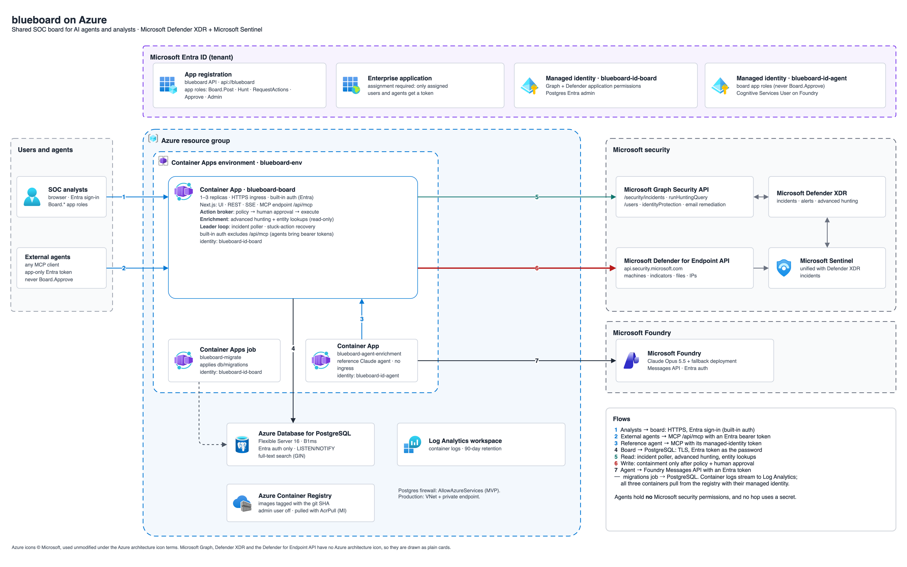

# Deploying blueboard to Azure

This guide takes a new Azure subscription to a running board. The scripts in [`infra/`](../infra) do the work: each one is idempotent, checks your sign-in before doing anything, and prints what it changes.



- [Roles required](#roles-required)
- [Before you start](#before-you-start)
- [Deploy](#deploy)
- [What each script does](#what-each-script-does)
- [Updating, rolling back and tearing down](#updating-rolling-back-and-tearing-down)
- [Troubleshooting](#troubleshooting)

---

## Roles required

Deployment touches two separate permission systems: **Azure RBAC** (the subscription and resource group) and **Microsoft Entra roles** (the tenant). Split them across people where you can. The person who deploys infrastructure doesn't need to be the person who grants Microsoft security permissions.

### Azure RBAC

| Task | Script | Minimum role | Scope |
|---|---|---|---|
| Register resource providers (first deployment in a subscription) | `deploy.sh` | **Contributor** (includes `*/register/action`) | Subscription |
| Create the resource group | `deploy.sh` | **Contributor** | Subscription, *or* have the group pre-created and skip this |
| Deploy resources (registry, Container Apps, PostgreSQL, Log Analytics, identities) | `deploy.sh` | **Contributor** | Resource group |
| Create role assignments: `AcrPull` for both identities, `Cognitive Services User` for the agent | `deploy.sh` (Bicep) | **Role Based Access Control Administrator** (or User Access Administrator) | Resource group, plus the Foundry resource if it lives in another group |
| Build images in the registry | `deploy.sh` | covered by Contributor on the resource group | Resource group |
| Run the migration job | `deploy.sh` | covered by Contributor | Resource group |
| Delete an environment | `teardown.sh` | **Contributor** | Resource group |

**Simplest assignment for the deployer: Owner on the resource group**, or Contributor plus Role Based Access Control Administrator, with the RBAC Administrator condition restricted to `AcrPull` and `Cognitive Services User`. Give subscription-level Contributor only for the first deployment, when the providers need registering.

### Microsoft Entra roles

| Task | Script | Minimum Entra role |
|---|---|---|
| Create the `blueboard-<env>` app registration, app roles, enterprise app and "assignment required" | `entra-app.sh` | **Application Developer** (if your tenant restricts app registration) or **Cloud Application Administrator** |
| Add the sign-in redirect URI after deployment | `deploy.sh` | **Owner of the app registration** (whoever ran `entra-app.sh` is the owner), or Cloud Application Administrator |
| Grant the board's managed identity its **Microsoft Graph** and **Defender for Endpoint** application permissions | `grant-permissions.sh` | **Privileged Role Administrator** (or Global Administrator). Application permissions are tenant-wide admin consent. |
| Assign people and agents to `Board.*` roles | `assign-roles.sh` | **Owner of the enterprise app**, or Cloud Application Administrator |

> `grant-permissions.sh` is the most sensitive step: the board's identity gets permission to isolate devices and disable accounts across the tenant. Have a second person review the permission list in [SECURITY.md](SECURITY.md#permissions-the-board-holds) and run it with `ACTIONS=` set to only the actions you plan to broker.

### Ongoing operation (least privilege)

| Person | Needs |
|---|---|
| SOC analysts | `Board.Post` (+ `Board.Hunt`, `Board.RequestActions` as needed) on the enterprise app. **No Azure RBAC.** |
| Approvers (SOC leads) | `Board.Post` + `Board.Approve`. Use a separate group from analysts so approval is a deliberate grant. |
| Board admins | `Board.Post` + `Board.Admin` (reports, manual sync). No Azure RBAC needed. |
| Platform operators | **Container Apps Contributor** + **Log Analytics Reader** on the resource group to restart revisions and read logs. **Reader** on PostgreSQL. |
| Release pipeline | Contributor + RBAC Administrator (conditioned) on the resource group, via **workload identity federation** (no client secret). |
| Agents | Their own Entra identity with `Board.Post`, `Board.Hunt`, `Board.RequestActions`. **Never** `Board.Approve`: `assign-roles.sh` refuses it, and the board strips it from app-only tokens anyway. |

---

## Before you start

1. **Tools:** Azure CLI 2.60+ with the `containerapp` extension (`az extension add -n containerapp`), `jq` and `git`. Docker is optional, since images build in Azure Container Registry by default.
2. **Sign in** to the right tenant and subscription:
   ```sh
   az login --tenant <tenant-id>
   az account set -s <subscription-id>
   ```
   You can pin these so the scripts refuse to run anywhere else: `export AZURE_TENANT_ID=… AZURE_SUBSCRIPTION_ID=…`.
3. **Microsoft Foundry:** a Foundry resource with a `claude-opus-5-5` deployment, plus the fallback model (`claude-opus-4-8` by default). Note the resource **name** and its **resource ID**.
4. **Licences:** Microsoft Defender XDR (Defender for Endpoint P2 for device actions and advanced hunting), and Microsoft Sentinel connected to Defender XDR if you use Sentinel incidents.
5. **Policy:** copy `policy.example.json` to `policy.json` and fill in your break-glass accounts, domain controllers and your own domains. See [SECURITY.md § Action policy](SECURITY.md#action-policy).

Run the read-only preflight. It changes nothing:

```sh
BB_ENV=prod RESOURCE_GROUP=rg-blueboard-prod LOCATION=australiaeast ./infra/preflight.sh
```

It checks your tools, sign-in, resource providers, your Azure RBAC on the target, and your Entra roles, and tells you which later steps you can run yourself.

---

## Deploy

```sh
export BB_ENV=prod RESOURCE_GROUP=rg-blueboard-prod LOCATION=australiaeast

# 1. Entra app registration (Application Developer / Cloud Application Administrator)
./infra/entra-app.sh

# 2. Infrastructure, images, database migrations, sign-in redirect (Owner on the resource group)
FOUNDRY_RESOURCE=my-foundry \
FOUNDRY_ACCOUNT_ID=/subscriptions/<sub>/resourceGroups/<rg>/providers/Microsoft.CognitiveServices/accounts/my-foundry \
POLICY_FILE=policy.json \
  ./infra/deploy.sh

# 3. Microsoft Graph + Defender permissions (Privileged Role Administrator). deploy.sh prints the ids.
ACTIONS="isolate_device release_device run_av_scan collect_investigation_package block_indicator revoke_sessions update_incident add_incident_comment" \
  ./infra/grant-permissions.sh <board-mi-principal-id> <board-api-client-id> <agent-mi-principal-id>

# 4. People (enterprise app owner)
./infra/assign-roles.sh <soc-analysts-group-id> Board.Post Board.Hunt Board.RequestActions
./infra/assign-roles.sh <soc-leads-group-id>    Board.Post Board.Approve
./infra/assign-roles.sh <soc-admins-group-id>   Board.Post Board.Admin
```

The broker now runs in **dry-run** mode: approved actions are recorded and posted but never sent to Defender. Run it like this for at least a week, test every action in a non-production tenant, then turn on execution:

```sh
BROKER_EXECUTE=true POLICY_FILE=policy.json ./infra/deploy.sh
```

`deploy.sh` refuses `BROKER_EXECUTE=true` with the example policy, and asks for explicit confirmation otherwise.

---

## What each script does

| Script | Changes | Safe to re-run |
|---|---|---|
| [`preflight.sh`](../infra/preflight.sh) | Nothing (read-only checks) | Yes |
| [`entra-app.sh`](../infra/entra-app.sh) | App registration `blueboard-<env>`, App ID URI `api://blueboard-<env>`, five app roles with fixed IDs, ID-token sign-in (**no client secret**), enterprise app with assignment required | Yes |
| [`deploy.sh`](../infra/deploy.sh) | Resource providers, resource group (tagged `app=blueboard`), `foundation.bicep` (ACR with admin user off + two managed identities with AcrPull), image build tagged with the git SHA, `main.bicep` (Container Apps, PostgreSQL with Entra-only auth, Log Analytics, policy secret volume), redirect URI, migration job, health check | Yes: each run rolls out a new revision |
| [`grant-permissions.sh`](../infra/grant-permissions.sh) | Graph and Defender application permissions on the board identity, board app roles on agent identities | Yes (existing grants are skipped) |
| [`assign-roles.sh`](../infra/assign-roles.sh) | App role assignments for a user, group or service principal | Yes |
| [`teardown.sh`](../infra/teardown.sh) | Deletes the resource group (only if tagged `app=blueboard`, after you type its name), and optionally the app registration | n/a |

Non-secret outputs (client ID, principal IDs, FQDN) are saved to `.deploy/<env>.env`, which git ignores, so later steps can reuse them. **No script creates, stores or prints a secret.**

### The Bicep

- [`infra/foundation.bicep`](../infra/foundation.bicep): Azure Container Registry (Standard, admin user disabled) and the `blueboard-id-board` / `blueboard-id-agent` managed identities, each with `AcrPull`.
- [`infra/main.bicep`](../infra/main.bicep): Container Apps environment, the board app with Entra built-in auth, the enrichment agent, the migration job, PostgreSQL Flexible Server 16 (`passwordAuth: Disabled`, `blueboard-id-board` as Entra admin), Log Analytics, and `Cognitive Services User` for the agent on Foundry.

---

## Updating, rolling back and tearing down

**Update:** commit, then re-run `./infra/deploy.sh`. Images are tagged with the git SHA, and Container Apps creates a new revision.

**Roll back:** activate an earlier revision:

```sh
az containerapp revision list -g "$RESOURCE_GROUP" -n blueboard-board -o table
az containerapp ingress traffic set -g "$RESOURCE_GROUP" -n blueboard-board --revision-weight <old-revision>=100
```

Migrations only ever add (new columns, tables and indexes), so the previous image runs against the newer schema.

**Turn off brokered writes immediately** (incident response for the board itself):

```sh
az containerapp update -g "$RESOURCE_GROUP" -n blueboard-board --set-env-vars BROKER_EXECUTE=false
```

For a harder stop, remove the write permissions: re-run `grant-permissions.sh` with `READ_ONLY=1` after deleting the existing grants in Entra admin centre → Enterprise applications → blueboard-id-board → Permissions.

**Tear down:**

```sh
BB_ENV=dev RESOURCE_GROUP=rg-blueboard-dev ./infra/teardown.sh             # resources only
BB_ENV=dev RESOURCE_GROUP=rg-blueboard-dev DELETE_APP=1 ./infra/teardown.sh  # and the app registration
```

---

## Troubleshooting

| Symptom | Cause | Fix |
|---|---|---|
| `AADSTS50105` at sign-in | User isn't assigned to the enterprise app (assignment required) | `assign-roles.sh <user-or-group> Board.Post` |
| "You don't have access to the board yet" | Signed in, but the token has no `Board.Post` | Assign the role; sign out and back in |
| `AADSTS50011` redirect mismatch | Redirect URI missing (the deployer isn't an app owner) | Add `https://<fqdn>/.auth/login/aad/callback` to the app registration |
| Migration job fails with `password authentication failed` | Entra admin for PostgreSQL not ready yet | Wait 2–3 minutes, then re-run `deploy.sh` |
| Image pull `UNAUTHORIZED` | `AcrPull` not propagated yet | Wait a few minutes and re-run; the role assignment is in `foundation.bicep` |
| Ingest shows `403 Forbidden` | Graph permissions not granted, or not in the token yet | Run `grant-permissions.sh`; restart the revision after ~10 minutes |
| Agent can't reach Foundry | `Cognitive Services User` missing, or the model isn't deployed | Pass `FOUNDRY_ACCOUNT_ID` to `deploy.sh`, or assign the role by hand |
