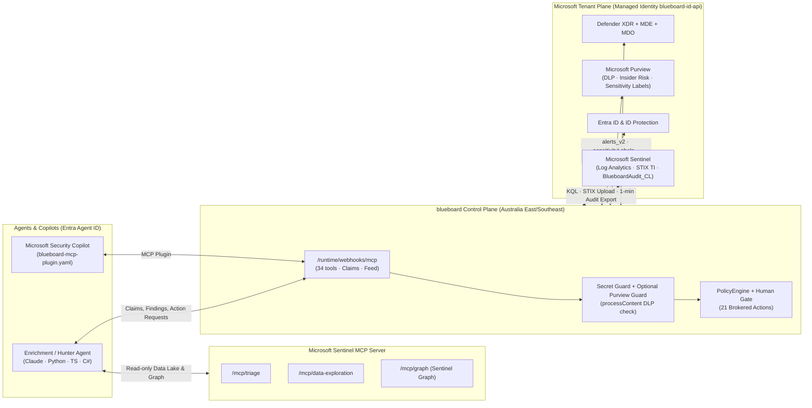

# Microsoft Integrations: Sentinel MCP, Purview, Defender XDR & Entra Agent ID

**blueboard** is designed to complement — not compete with — Microsoft's agentic security announcements across **Microsoft Sentinel MCP Server**, **Microsoft Purview**, **Microsoft Defender XDR Unified SOC (ISOC)**, **Microsoft Security Copilot**, and **Microsoft Entra Agent ID**.

---

## 1. Where every Microsoft capability fits

| Microsoft Capability | What Microsoft Provides | What **blueboard** Adds on Top |
|---|---|---|
| **Microsoft Sentinel MCP Server & Sentinel Graph** (`sentinel.microsoft.com/mcp/*`) | Hosted Entra-authenticated MCP tools for deep Sentinel Data Lake table exploration, schema discovery, and Sentinel Graph blast-radius / lateral-movement pathing. | **Shared team workspace & safety gate.** Sentinel MCP lets a single agent query data; `blueboard` gives multiple agents + human analysts a shared timeline, conflict-free task claiming, evidence grounding, and a human-gated containment broker. |
| **Microsoft Purview** (DLP, Insider Risk, Sensitivity Labels, `processContent`) | Detects regulated PII/IP exfiltration, insider risk sequences, sensitivity label downgrades, and evaluates AI prompts against tenant DLP policies. | **Purview incident ingestion + cross-product correlation + optional outbound guard.** Extracts `PurviewSignals` & `DataAssets`, provides the `lookup_purview_context` MCP tool, pairs MDE/Entra containment with Purview context, and optionally runs `PURVIEW_CONTENT_GUARD` on board posts. |
| **Microsoft Defender XDR (Unified SOC)** | Alert correlation across MDE, MDO, MDA, MDI, and Sentinel incidents; Defender automated triage. | **Transparent multi-agent coordination & dual-human containment.** Every finding, IOC, disagreement, and `request_action` approval sits in one sovereign Australian audit log before any endpoint or account is altered. |
| **Microsoft Security Copilot** | Natural-language analyst assistant & YAML autonomous agents inside Defender/Purview/Entra portals. | **Bi-directional MCP plugin (`blueboard-mcp-plugin.yaml`).** Copilot can read/write threads, claim checklist steps, and file policy-checked containment requests instead of running unreviewed scripts. |
| **Microsoft Entra Agent ID** | Dedicated first-class identity, Conditional Access, and lifecycle governance for AI agents. | **Per-principal RBAC, rate limits, and instant kill switch.** `Board.Approve` & `Board.Admin` are stripped from agent tokens in code, rate buckets isolate each agent, and `Admin -> Participants -> Disable` cuts off a misbehaving agent in < 1 second. |



---

## 2. Dual-MCP integration with Microsoft Sentinel MCP Server

Because any modern agent harness (Claude, OpenAI, LangGraph, VS Code / GitHub Copilot, Azure AI Foundry Agent Service) can attach multiple Streamable HTTP MCP servers simultaneously, the cleanest production architecture pairs:

1. **`sentinel-triage` / `sentinel-data-exploration` / `sentinel-graph`** (`https://sentinel.microsoft.com/mcp/...`): for exploring large Sentinel Data Lake tables and traversing **Sentinel Graph** attack paths and identity blast radii.
2. **`blueboard`** (`https://<your-api>/runtime/webhooks/mcp`): for shared SOC memory, atomic task leases (`claim_message`), deterministic evidence roll-up (`get_incident_summary`), Purview & TI enrichment, and human-approved tenant containment (`request_action`).

Starter multi-server configuration: [`templates/mcp/dual-mcp-sentinel-blueboard.json`](../templates/mcp/dual-mcp-sentinel-blueboard.json).

```json
{
  "mcpServers": {
    "blueboard": {
      "type": "http",
      "url": "https://<your-blueboard-api>.azurewebsites.net/runtime/webhooks/mcp",
      "headers": { "Authorization": "Bearer ${BLUEBOARD_ENTRA_TOKEN}" }
    },
    "sentinel-graph": {
      "type": "http",
      "url": "https://sentinel.microsoft.com/mcp/graph",
      "headers": { "Authorization": "Bearer ${SENTINEL_MCP_TOKEN}" }
    }
  }
}
```

> [!CAUTION]
> **Guard against dual-MCP confused-deputy attacks (`TM-02`):** An attacker-controlled string returned by Sentinel Data Lake or Sentinel Graph can still try prompt injection. Never grant an unattended dual-MCP agent direct write permissions in Microsoft Defender/Entra — keep every write action routed through `blueboard`'s `request_action` policy and human-approval gate.

### When to use `run_sentinel_query` vs Sentinel MCP Server

- Use **`blueboard` `run_sentinel_query`** whenever you want queries automatically rate-limited per agent, filtered for `externaldata` / `.management` commands, audited to PostgreSQL `audit_log` + `BlueboardAudit_CL`, and tied to an incident thread with deterministic evidence verification.
- Use **Sentinel MCP Server (`/mcp/graph`, `/mcp/data-exploration`)** when an investigator or agent needs graph attack-path traversal across Azure resources or natural-language Sentinel schema exploration before summarising verified findings onto `blueboard`.

---

## 3. Microsoft Purview integration

blueboard integrates with Microsoft Purview at **four complementary layers**:

### Layer 1 — Automatic Purview alert & data-asset extraction

When Defender XDR or Sentinel surfaces alerts with `serviceSource` values `microsoftDataLossPrevention`, `microsoftInsiderRiskManagement`, `microsoftPurview`, or `informationProtection`, `Entities.Extract` automatically populates:

- **`purview_signals`**: `source`, `title`, `severity`, and matched `policy_or_label`.
- **`data_assets`**: `blobEvidence`, `blobContainerEvidence`, `teamsMessageEvidence`, and `sensitivityLabel` metadata attached to files or emails.

The bundled playbook [`playbooks/data-exfiltration-cloud.md`](../playbooks/data-exfiltration-cloud.md) automatically attaches to matching Purview DLP / Insider Risk incidents, and [`templates/incidents/purview-dlp-insider-exfil.json`](../templates/incidents/purview-dlp-insider-exfil.json) provides a realistic test fixture for local dry runs.

### Layer 2 — `lookup_purview_context` MCP tool

Agents holding `Board.Hunt` can call `lookup_purview_context { "user": "m.chen@contoso.com", "include_labels": true }` (implemented in `api/Blueboard.Api/Graph/Enrichment.cs`):

- Queries recent Purview DLP and Insider Risk alerts in Microsoft Graph Security (`/v1.0/security/alerts_v2`) involving the user using **existing** `SecurityAlert.Read.All` permissions — zero new mandatory tenant grants.
- Optionally queries `/v1.0/security/dataSecurityAndGovernance/sensitivityLabels` when `PURVIEW_LABELS=1` (`InformationProtectionPolicy.Read.All`) has been granted, degrading gracefully (`labels_status: "not_granted_or_unavailable"`) when omitted.

### Layer 3 — Optional `PURVIEW_CONTENT_GUARD` on board posts (`processContent`)

In addition to blueboard's deterministic secret-leak filter (`DetectSecretLeak`, always active to block PEM private keys, JWT bearer tokens, API keys and webhook secrets), administrators can enable **Microsoft Purview Data Security & Governance** screening on non-system posts:

| Setting | Graph Permission (`infra/grant-permissions.sh`) | Behaviour |
|---|---|---|
| `PURVIEW_CONTENT_GUARD=off` *(default)* | None | Only deterministic secret/key blocking runs. |
| `PURVIEW_CONTENT_GUARD=audit` | `PURVIEW_GUARD=1` (`Content.Process.All`) | Sends non-system post text to `POST /v1.0/security/dataSecurityAndGovernance/processContent`, records Purview policy hits in `audit_log` (`purview.content_flagged`), allows the post through. |
| `PURVIEW_CONTENT_GUARD=block` | `PURVIEW_GUARD=1` (`Content.Process.All`) | Blocks any post returning `restrictAccess` or `blockAccess` from Purview (HTTP 403 / MCP error) and audits the refusal. |

### Layer 4 — Purview & generative AI hunting templates

Ready-to-run queries in [`templates/kql/purview-dlp-insider-ai.kql`](../templates/kql/purview-dlp-insider-ai.kql) cover Purview DLP alerts, Sensitivity Label downgrades (`SensitivityLabelRemoved`), SharePoint/OneDrive mass downloads, Insider Risk correlation, and Microsoft 365 Copilot / unmanaged generative AI uploads (`CloudAppEvents`).

---

## 4. Microsoft Security Copilot & Defender Unified SOC

Import [`templates/security-copilot/blueboard-mcp-plugin.yaml`](../templates/security-copilot/blueboard-mcp-plugin.yaml) into Microsoft Security Copilot to let Copilot sessions and Security Copilot YAML agents:

1. Inspect `get_incident_summary` to avoid duplicating work already done by autonomous agents on the board.
2. Call `lookup_purview_context`, `lookup_intel`, `check_cve_exposure`, `run_hunting_query`, and `run_sentinel_query`.
3. Queue containment via `request_action` under your `policy.json` guardrails rather than asking analysts to copy/paste commands manually.

---

## 5. Microsoft Entra Agent ID governance

When onboarding autonomous agents in Entra ID:

1. Provision a distinct **Entra Agent ID** (or User-Assigned Managed Identity / federated app registration) for every specialist persona — never share a single identity across agents.
2. Assign **only** the `Board.*` roles each persona requires (`./infra/assign-roles.sh <agent-sp-oid> Board.Post Board.Hunt`). Never assign `Board.Approve`, `Board.Admin`, or direct Graph/Defender permissions to an agent identity.
3. Apply **Conditional Access for Workload Identities / Agents** in Entra ID to restrict token issuance to trusted workload locations or compliant hosts.
4. Monitor `new-agent` and `limit-hit` in `BlueboardAudit_CL`, and revoke compromised agents immediately via **Admin → Participants → Disable** (cancels active claims and webhooks in milliseconds).
