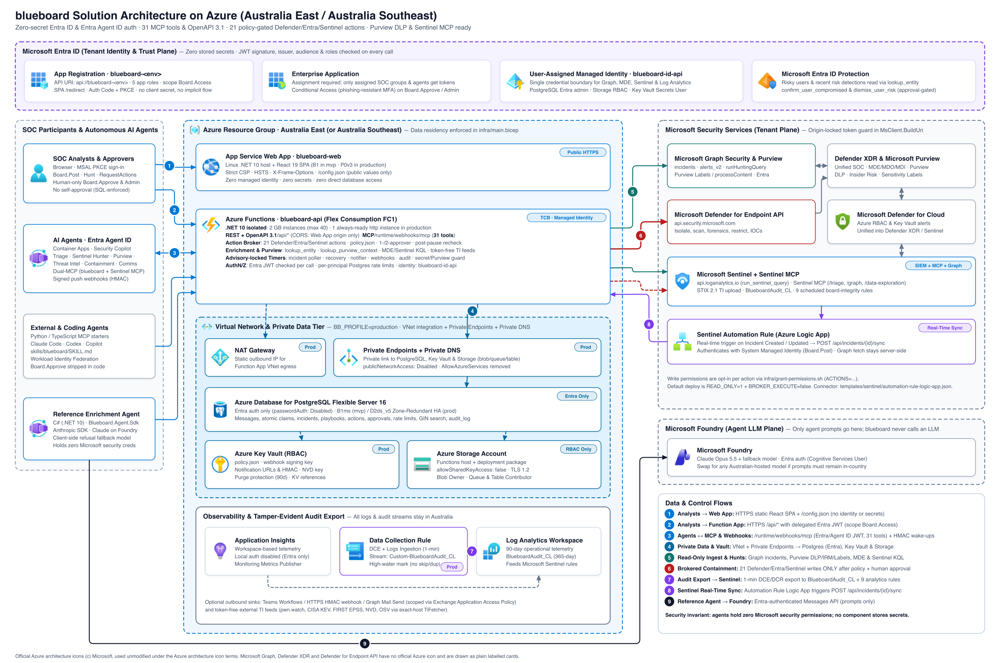

# blueboard Deployment Guide

This guide takes an Australian Azure subscription (`australiaeast` or `australiasoutheast`) from preflight checks to a verified, production-ready **blueboard** deployment connected to Microsoft Defender XDR, Microsoft Sentinel and Microsoft Entra ID. Every script in `infra/` is idempotent, verifies your active Azure CLI tenant and subscription before modifying state, and stores zero secrets.

## Document control

| Item | Value |
|---|---|
| Document | blueboard Deployment Guide |
| Version | 2.1 |
| Date | 25-11-2026 |
| Status | Published |
| Owner | blueboard SOC platform team |
| Audience | Azure platform engineers, Entra ID administrators, SOC leads |
| Related | Administrator SOPs; Developer Guide; Security Controls; Solution Design Document; Walkthrough Guides |

## Contents

1. [What gets deployed](#1-what-gets-deployed)
2. [Prerequisites and roles](#2-prerequisites-and-roles)
3. [Before you deploy: policy and preflight](#3-before-you-deploy-policy-and-preflight)
4. [First-time deployment (`up.sh`)](#4-first-time-deployment-upsh)
5. [Step-by-step deployment (separated duties)](#5-step-by-step-deployment-separated-duties)
6. [Sentinel Automation Rule real-time sync connector](#6-sentinel-automation-rule-real-time-sync-connector)
7. [Post-deployment verification](#7-post-deployment-verification)
8. [Configuration and environment variable reference](#8-configuration-and-environment-variable-reference)
9. [Upgrading, rolling back and tearing down](#9-upgrading-rolling-back-and-tearing-down)
10. [Troubleshooting](#10-troubleshooting)

## 1. What gets deployed



`infra/main.bicep` deploys all infrastructure into one resource group in `australiaeast` (default) or `australiasoutheast` (any other region is refused by both the scripts and Bicep). Two profiles are supported via `BB_PROFILE`:

| Component | `mvp` profile (default) | `production` profile (`BB_PROFILE=production`) |
|---|---|---|
| **Web App** (`blueboard-web-<suffix>`) | App Service Linux (.NET 10 host + React build), B1 (`WEB_SKU`), HTTPS-only, TLS 1.2, FTP & basic-auth publishing off, **no identity** | P0v3 plan, same zero-identity hardened host |
| **Function App** (`blueboard-api-<suffix>`) | Flex Consumption (FC1), .NET 10 isolated, 2 GB instances, max 40, CORS locked to Web App origin, Entra JWT auth per call | Same inbound; **VNet integration** for outbound through NAT Gateway (static egress IP); **1 always-ready `http` instance** |
| **PostgreSQL Flexible Server 16** (`blueboard-pg-<suffix>`) | Burstable `Standard_B1ms`, 32 GB, 14-day backups, **Entra auth only** (`passwordAuth: Disabled`), `AllowAzureServices` rule | General Purpose `D2ds_v5`, **zone-redundant HA** (same-zone in `australiasoutheast`), **Private Endpoint only**, `publicNetworkAccess: Disabled` |
| **Host Storage** (`blueboardst<suffix>`) | Standard LRS, `allowSharedKeyAccess: false`, TLS 1.2, accessed via managed identity data roles | **Private Endpoints** (blob, queue, table), public network access disabled |
| **Secret & policy storage** | `@secure()` Function App settings (never written to deployment history or `state.json`) | **Azure Key Vault** (RBAC mode, purge protection, Private Endpoint) read via Key Vault references by `blueboard-id-api` |
| **Observability** | Application Insights (local auth disabled) + Log Analytics (90 days) | Same + **Data Collection Endpoint, Data Collection Rule and `BlueboardAudit_CL` custom table** (365-day retention) for Sentinel export |
| **Managed Identity** | 1 user-assigned identity (`blueboard-id-api`) holding Graph/MDE app permissions, Postgres Entra admin, Storage roles and Monitoring Metrics Publisher | Same + **Key Vault Secrets User** (and optional **Microsoft Sentinel Contributor** / **Log Analytics Reader**) |

### Data residency

Every resource created by `main.bicep` resides in your chosen Australian region. Three external services operate outside the resource group:

1. **Microsoft Entra ID**: your tenant's home geography (authentication only).
2. **Microsoft Graph, Defender XDR, Defender for Endpoint, Sentinel**: your tenant's M365/Azure geography; blueboard reads/writes via API and stores its operational copy in Australia.
3. **LLM provider (agents only)**: blueboard itself never calls a model. If you run the reference `Blueboard.EnrichmentAgent` on Claude in Microsoft Foundry, prompts are processed in the Foundry region you choose; you can attach any agent running on an Australian-hosted model instead.

## 2. Prerequisites and roles

### 2.1 Workstation tools

Install and verify:

- Azure CLI `2.60+`
- `jq`, `git`, `zip`
- `.NET 10 SDK`
- `Node 22` + `pnpm` (`corepack enable`)

Sign in and pin the tenant and subscription so scripts refuse to operate elsewhere:

```sh
az login --tenant <tenant-id>
az account set -s <subscription-id>
export AZURE_TENANT_ID=<tenant-id>
export AZURE_SUBSCRIPTION_ID=<subscription-id>
```

### 2.2 Separation of duties (Azure RBAC vs Entra ID)

| Duty | Script | Minimum role | Scope |
|---|---|---|---|
| Register Azure providers (first run) & create resource group | `deploy.sh` | **Contributor** | Subscription (or pre-create RG) |
| Deploy Bicep resources & publish code packages | `deploy.sh` | **Contributor** | Resource group |
| Create storage, monitoring, Key Vault & Sentinel role assignments | `deploy.sh` (Bicep) | **Role Based Access Control Administrator** (or User Access Administrator) | Resource group (and Sentinel workspace if `ASSIGN_SENTINEL_CONTRIBUTOR=true`) |
| Create `blueboard-<env>` Entra app registration & enterprise app | `entra-app.sh` | **Application Developer** or **Cloud Application Administrator** | Tenant |
| Grant tenant-wide admin consent for SPA sign-in scopes | `entra-app.sh` | **Cloud Application Administrator** | Tenant |
| Grant Graph & Defender **application** permissions to `blueboard-id-api` | `grant-permissions.sh` | **Privileged Role Administrator** (or Global Administrator) | Tenant |
| Assign users, groups & agents to `Board.*` roles | `assign-roles.sh` | **Owner** of enterprise app or **Cloud Application Administrator** | Enterprise application |

For least-privilege Azure RBAC, condition the deployer's **Role Based Access Control Administrator** role to these role definition IDs:

- *Storage Blob Data Owner*: `b7e6dc6d-f1e8-4753-8033-0f276bb0955b`
- *Storage Queue Data Contributor*: `974c5e8b-45b9-4653-ba55-5f855dd0fb88`
- *Storage Table Data Contributor*: `0a9a7e1f-b9d0-4cc4-a60d-0319b160aaa3`
- *Monitoring Metrics Publisher*: `3913510d-42f4-4e42-8a64-420c390055eb`
- *Key Vault Secrets User* (`production`): `4633458b-17de-408a-b874-0445c86b69e6`
- *Microsoft Sentinel Contributor* (only if `ASSIGN_SENTINEL_CONTRIBUTOR=true`): `ab8e14d6-4a74-4f29-9ba8-549422addade`

## 3. Before you deploy: policy and preflight

1. Choose a starter policy from `templates/policies/` (`starter-readonly.json`, `starter-balanced-soc.json`, or `starter-strict-regulated.json`) and copy it to `policy.json` (git-ignored).
2. Populate `protected_users` (UPN + Entra OID), `protected_devices` (MDE ID + FQDN), `protected_apps` (Entra SP ObjectId / AppId / display name) and `protected_indicators` (corporate domains, IdPs, CDNs, resolvers).
3. Validate offline:

   ```sh
   dotnet run --project api/Blueboard.Tools -- policy-check policy.json
   ```

4. Run the read-only preflight check:

   ```sh
   BB_ENV=prod RESOURCE_GROUP=rg-blueboard-prod LOCATION=australiaeast ./infra/preflight.sh
   ```

   Preflight checks your local tools, sign-in context, Azure provider registrations, Flex Consumption availability in the region, your Azure RBAC permissions and your Entra roles without changing anything.

## 4. First-time deployment (`up.sh`)

Run the resumable orchestrator. Start in **read-only, dry-run** mode (the default — no write permissions granted, `BROKER_EXECUTE=false`):

```sh
# MVP profile
BB_ENV=prod POLICY_FILE=policy.json ./infra/up.sh

# Production profile (private endpoints, VNet + NAT GW, Key Vault, HA Postgres, Sentinel audit export)
BB_ENV=prod BB_PROFILE=production POLICY_FILE=policy.json ./infra/up.sh
```

What `up.sh` does:

1. Runs `preflight.sh`, `entra-app.sh` and `deploy.sh`.
2. Records non-secret state (resource names, IDs, hostnames, remembered non-secret flags) in `infra/out/<env>/state.json`. `lib.sh` refuses to write any secret key to `state.json`.
3. If you hold **Privileged Role Administrator**, runs `grant-permissions.sh` (read-only unless `ACTIONS=` is set). If you do not, `up.sh` stops cleanly and writes `infra/out/<env>/handoff.md` containing the exact command, object IDs and permission review list to pass to your Entra administrator. Once they run it, re-run `up.sh` to resume and finish.
4. Queries `GET /api/setup` with your Entra token (if you hold `Board.Admin`) and prints one line per health check.

**Important**: `BROKER_EXECUTE` and all secret variables (`NOTIFY_TEAMS_WEBHOOK_URL`, `NOTIFY_WEBHOOK_URL`, `NOTIFY_WEBHOOK_SECRET`, `NVD_API_KEY`, `WEBHOOK_SIGNING_KEY`) are **never** stored in `state.json` and must be passed on every run that uses them.

## 5. Step-by-step deployment (separated duties)

When infrastructure engineers and Entra administrators operate separately:

```sh
export BB_ENV=prod RESOURCE_GROUP=rg-blueboard-prod LOCATION=australiaeast

# 1. Entra app registration (Application Developer / Cloud App Admin)
./infra/entra-app.sh

# 2. Azure infrastructure + API & Web packages (RG Owner or Contributor + RBAC Admin)
BB_PROFILE=production POLICY_FILE=policy.json \
  SENTINEL_WORKSPACE_RESOURCE_ID="/subscriptions/<sub>/resourceGroups/<rg>/providers/Microsoft.OperationalInsights/workspaces/<ws>" \
  ./infra/deploy.sh

# 3. Microsoft Graph & Defender permissions (Privileged Role Administrator)
# Phase 1: read-only
READ_ONLY=1 ./infra/grant-permissions.sh <api-mi-principal-id> <board-api-client-id>

# Phase 2 (later): add low-risk writes, then containment writes
ACTIONS="run_av_scan collect_investigation_package tag_device add_incident_comment" \
  ./infra/grant-permissions.sh <api-mi-principal-id> <board-api-client-id>

# 4. Grant Log Analytics Reader if using run_sentinel_query
az role assignment create \
  --assignee-object-id <api-mi-principal-id> \
  --assignee-principal-type ServicePrincipal \
  --role "Log Analytics Reader" \
  --scope "<sentinel-workspace-resource-id>"

# 5. Assign Entra security groups to board roles (Enterprise App Owner)
./infra/assign-roles.sh <soc-analysts-group-id> Board.Post Board.Hunt Board.RequestActions
./infra/assign-roles.sh <soc-leads-group-id>    Board.Post Board.Approve
./infra/assign-roles.sh <soc-admins-group-id>   Board.Post Board.Admin
```

## 6. Sentinel Automation Rule real-time sync connector

By default blueboard polls Microsoft Graph for incidents on a timer. For sub-5-second incident creation from Microsoft Sentinel:

1. Deploy the Azure Logic App template `templates/sentinel/automation-rule-logic-app.json` into your Sentinel resource group, setting `blueboardApiBaseUrl` (`https://<api-host>`) and `blueboardApiAudience` (`api://blueboard-<env>`).
2. Assign `Board.Post` to the Logic App's system-assigned managed identity:

   ```sh
   ./infra/assign-roles.sh <logic-app-mi-principal-id> Board.Post
   ```

3. In Microsoft Sentinel → **Automation → Create → Automation rule**, trigger on **When incident is created** (and optionally **When incident is updated**), and choose **Run playbook** pointing at the deployed Logic App.
4. Each trigger sends `POST /api/incidents/{incidentNumber}/sync`; blueboard fetches the authoritative incident record directly from Microsoft Graph using `blueboard-id-api` (never trusting webhook body fields).

## 7. Post-deployment verification

1. Verify `/api/healthz` returns `200 OK` and Web App `/healthz` returns `200 OK`.
2. In the `production` profile, verify PostgreSQL public access is disabled:

   ```sh
   az postgres flexible-server show -g "$RESOURCE_GROUP" -n <pg-server-name> \
     --query network.publicNetworkAccess -o tsv
   # Expected: Disabled
   ```

3. Open `https://<web-host>/setup` (as a `Board.Admin` user) and confirm all 10 checks report **OK** (or expected **Warning** for dry run / unconfigured optional sinks).
4. Verify permissions without modifying anything:

   ```sh
   CHECK=1 ACTIONS="…" ./infra/grant-permissions.sh <api-mi-principal-id> <board-api-client-id>
   ```

5. If using `production` profile, import all 9 Sentinel analytics rules (`for f in infra/sentinel/*.json; do az deployment group create -g <sentinel-rg> -f "$f" -p workspace=<ws>; done`).
6. Run in dry-run mode (`BROKER_EXECUTE=false`) for at least one week, exercise every enabled action in a non-production tenant, review **Reports → Dry-run**, and only then enable execution:

   ```sh
   BROKER_EXECUTE=true POLICY_FILE=policy.json ./infra/deploy.sh
   ```

## 8. Configuration and environment variable reference

| Variable | Default | Stored in `state.json` | Purpose |
|---|---|---|---|
| `BB_ENV` | `dev` | Yes | Environment suffix (`dev`, `test`, `prod`) |
| `BB_PROFILE` | `mvp` | Yes | `mvp` or `production` |
| `RESOURCE_GROUP` | `rg-blueboard-<env>` | Yes | Target Azure resource group |
| `LOCATION` | `australiaeast` | Yes | `australiaeast` or `australiasoutheast` only |
| `POLICY_FILE` | `policy.example.json` | Path only | Action policy JSON loaded into `BLUEBOARD_POLICY_JSON` and parsed directly in memory at start-up with zero temporary files written to disk (refused with `BROKER_EXECUTE=true` if example file) |
| `BROKER_EXECUTE` | `false` | **Never** | Must be passed explicitly on every deploy that enables live writes |
| `ACTIONS` | *(empty — read-only)* | Yes | Space-separated list of brokered actions (or `all`) for `grant-permissions.sh` |
| `SENTINEL_WORKSPACE_ID` | *(unset)* | Yes | Log Analytics Workspace GUID for `run_sentinel_query` & `publish_ti_indicator` |
| `ASSIGN_SENTINEL_CONTRIBUTOR` | `false` | Yes | Grants **Microsoft Sentinel Contributor** on Sentinel workspace for `publish_ti_indicator` |
| `PURVIEW_CONTENT_GUARD` | `off` | Environment | `off \| audit \| block` — optional Microsoft Purview `processContent` DLP check on outbound board posts (`PURVIEW_GUARD=1` in `grant-permissions.sh`); deterministic PEM/JWT/token leak blocking always runs |
| `NOTIFY_TEAMS_WEBHOOK_URL` | *(unset)* | **Never** | Teams Workflows / incoming webhook URL (`@secure()`) |
| `NOTIFY_WEBHOOK_URL` / `NOTIFY_WEBHOOK_SECRET` | *(unset)* | **Never** | Generic HTTPS webhook & ≥ 32-char HMAC secret (`@secure()`) |
| `NOTIFY_ALLOWED_HOSTS` | *(unset)* | Yes | Comma-separated exact HTTPS hostnames for notification webhooks |
| `NOTIFY_MAIL_FROM` / `NOTIFY_MAIL_TO` | *(unset)* | Yes | Shared mailbox sender and comma-separated approver recipients (`NOTIFY_MAIL=1`) |
| `NOTIFY_REMIND_MINUTES` | `15` | Yes | Pending approval reminder interval (max 8 reminders) |
| `WEBHOOK_ALLOWED_HOSTS` | *(unset)* | Yes | Comma-separated exact HTTPS hostnames for agent wake-up webhooks |
| `WEBHOOK_SIGNING_KEY` | *(unset)* | **Never** | Base64 of ≥ 32 random bytes for agent webhook HMAC-SHA256 (`@secure()`) |
| `TI_*_ENABLED` | `false` | Yes | Enable individual TI sources (`PWNWATCH`, `KEV`, `EPSS`, `NVD`, `OSV`, `SENTINEL`, `EXPOSURE`, `MSTI`) |
| `NVD_API_KEY` | *(unset)* | **Never** | Optional NVD API key (50 vs 5 req / 30 s) |
| `EXTRA_CORS_ORIGINS` | *(unset)* | Yes | Additional allowed browser origins (e.g. custom Web App domain) |
| `BOARD_WEB_URL` | Web App host | Yes | Base URL used in approver notification deep links |
| `CLAIM_LEASE_SECONDS` | `600` | Yes | Atomic claim lease TTL in seconds |

## 9. Upgrading, rolling back and tearing down

### 9.1 Upgrade

Commit or check out the target release and re-run `up.sh` (or `deploy.sh`). Remembered non-secret settings from `infra/out/<env>/state.json` are reused; pass `BROKER_EXECUTE=true` and any secret variables again on the command line. Database migrations in `db/migrations/` run automatically on Function App start-up.

### 9.2 Roll back

All SQL migrations are strictly additive (new tables, columns and indexes only), so an older API build continues to run against a newer schema:

```sh
git checkout <previous-tag-or-commit>
BB_ALLOW_DIRTY=1 BROKER_EXECUTE=true POLICY_FILE=policy.json ./infra/deploy.sh
```

### 9.3 Tear down

```sh
BB_ENV=dev ./infra/teardown.sh                # deletes RG tagged app=blueboard after confirmation
BB_ENV=dev DELETE_APP=1 ./infra/teardown.sh   # also deletes the Entra app registration
```

Note: in the `production` profile, Key Vault has purge protection enabled for 90 days. Because the vault name derives from the resource group name, redeploying a torn-down production environment requires a new `RESOURCE_GROUP` name.

## 10. Troubleshooting

| Symptom | Cause | Fix |
|---|---|---|
| `AADSTS50105` on sign-in | User not assigned to `blueboard-<env>` enterprise app | Run `./infra/assign-roles.sh <group-or-user-id> Board.Post`. |
| `AADSTS50011` redirect mismatch | SPA redirect URI missing on app registration | Re-run `WEB_HOSTNAME=<web-host> ./infra/entra-app.sh`. |
| `AADSTS65001` consent required | Tenant-wide admin consent not granted | Run `az ad app permission admin-consent --id <client-id>` as Cloud Application Administrator. |
| Browser CORS error on `/api/*` | Custom domain missing from Function App CORS list | Redeploy with `EXTRA_CORS_ORIGINS="https://<custom-host>"`. |
| `/api/healthz` returns 503 after deploy | Initial migrations running or Postgres Entra admin propagating | Wait 2–3 minutes; check Application Insights for `database migration failed`. |
| Ingest returns `403 Forbidden` | Graph application permissions not granted or token cached | Run `grant-permissions.sh`, wait ~10 minutes, and restart the Function App. |
| `VaultAlreadyExists` on production redeploy | Soft-deleted purge-protected vault from earlier teardown | Deploy with a new `RESOURCE_GROUP` name. |
