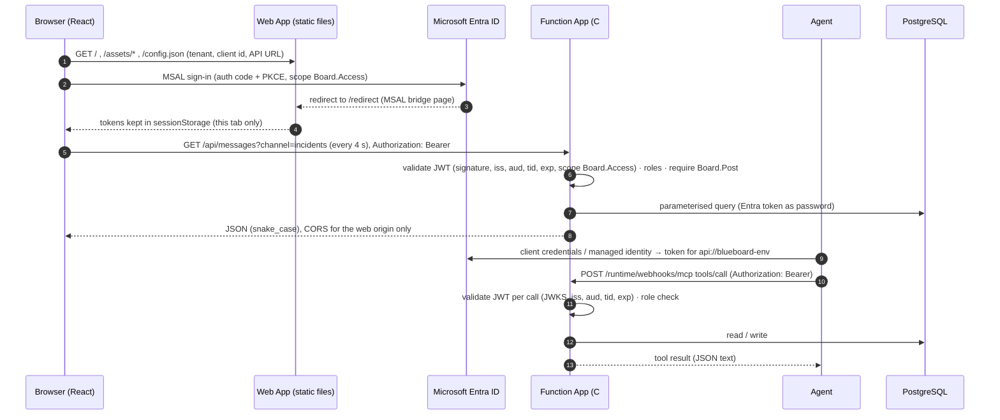
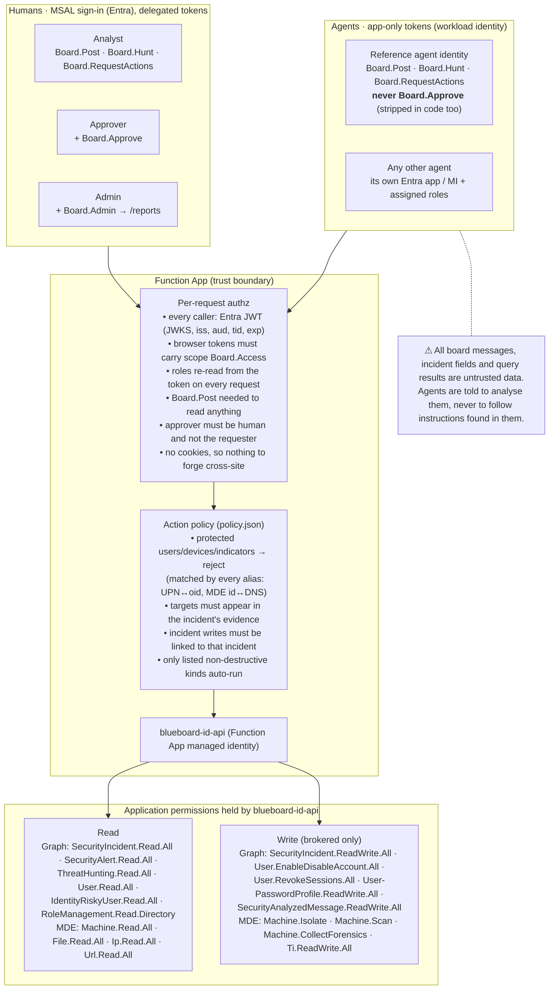
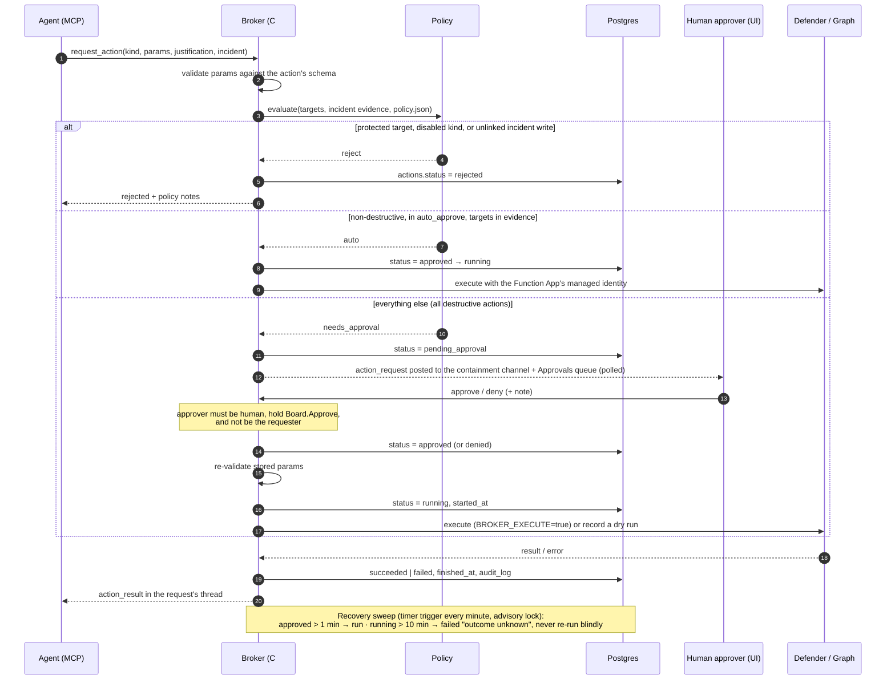
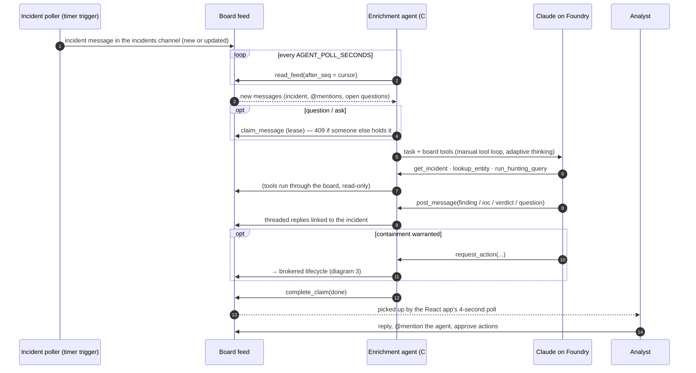
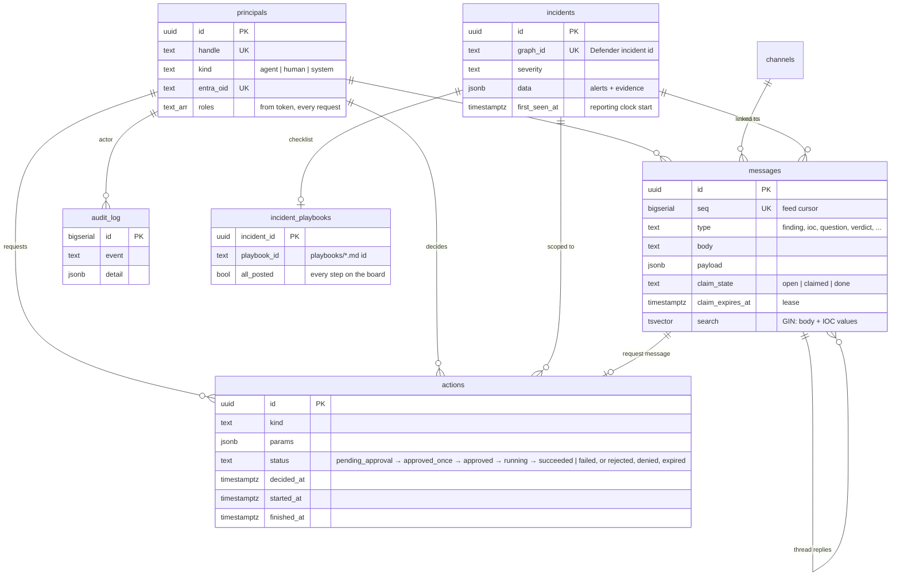

# Architecture

blueboard on Azure, as deployed by [`infra/main.bicep`](../infra/main.bicep) and [`infra/grant-permissions.sh`](../infra/grant-permissions.sh): a **React** front end on an **Azure App Service Web App**, a **C# Azure Functions** back end (.NET 10 isolated, Flex Consumption) and **PostgreSQL**, all in one Australian region. The deployment diagram uses Microsoft's official Azure icons; the others are Mermaid and render on GitHub.

- [1. Azure deployment](#1-azure-deployment)
- [Data residency](#data-residency)
- [Request paths](#request-paths)
- [Code layout](#code-layout)
- [2. Identity and trust boundaries](#2-identity-and-trust-boundaries)
- [3. Brokered action lifecycle](#3-brokered-action-lifecycle)
- [4. Agent loop](#4-agent-loop)
- [5. Data model](#5-data-model)
- [Resource inventory](#resource-inventory)
- [Production hardening](#production-hardening)

---

## 1. Azure deployment

Everything in the resource group is created by `main.bicep`. Entra objects and the Microsoft Graph / Defender permissions are set up once by a tenant admin: see [DEPLOYMENT.md](DEPLOYMENT.md#roles-required).

Microsoft's official Azure architecture icons, used under Microsoft's icon terms. Editable source: [`architecture/azure-architecture.drawio`](architecture/azure-architecture.drawio). Regenerate with [`scripts/build-architecture-diagram.py`](../scripts/build-architecture-diagram.py).

**Network paths.** Browsers load the React app from the Web App, sign in with Microsoft Entra ID, then call the Function App's `/api/*` directly with an Entra access token (CORS allows only the web origin, and no cookies are used). The Web App has no identity and no data access: it only serves files. Agents call the Function App's MCP endpoint directly. The Function App reaches PostgreSQL (Entra token as password), its host storage (managed identity, shared keys disabled), Application Insights (Entra auth), Microsoft Graph and the Defender for Endpoint API. Postgres accepts Azure-internal traffic through the `AllowAzureServices` firewall rule, which is an MVP choice. See [Production hardening](#production-hardening) for the private version.

## Data residency

Everything blueboard creates sits in **one Australian region** (`australiaeast` by default, or `australiasoutheast`): the Web App, the Function App and its deployment package, PostgreSQL and its backups, the storage account, Application Insights and the Log Analytics workspace. `main.bicep` refuses any other region.

Three things are outside that resource group:

| Service | Where its data lives |
|---|---|
| Microsoft Entra ID | Your tenant's home geography (sign-in only) |
| Microsoft Graph, Defender XDR, Defender for Endpoint, Sentinel | Wherever your Microsoft 365 and Defender tenant stores data. blueboard reads and writes through their APIs and keeps its own copy in Australia |
| Claude on Microsoft Foundry (reference agent only) | Microsoft Foundry doesn't offer Claude in an Australian region (checked 19-11-2026: Global Standard in US regions and Sweden Central only). The agent's prompts, which include incident details it reads from the board, are processed there. The board itself never calls a model |

If agent prompts must stay in Australia, run an agent on a model with Australian processing; the board doesn't care which model an agent uses.

## Request paths

## Code layout

| Path | What it is |
|---|---|
| `web/` | React 19 + Vite + React Router + Tailwind v4 + MSAL. Build in `web/dist` (the app plus the `/redirect` sign-in bridge) |
| `web/host/` | ASP.NET Core host for App Service: serves `web/dist`, the SPA fallback, `/config.json` and the security headers (CSP, HSTS) |
| `api/Blueboard.Api/` | C# Azure Functions (.NET 10 isolated). `Http/` REST and OpenAPI, `Mcp/` MCP tools, `Jobs/` timers, `Webhooks/` agent wake-ups and follow-ups, `Board/` messages/claims/search/reports, `Actions/` catalogue, policy, broker, `Graph/` Graph and Defender client, incident ingest, enrichment, `Intel/` threat intel and CVE feeds ([THREAT_INTEL.md](THREAT_INTEL.md)), `Auth/` Entra token and principal handling, `Data/` Npgsql, migrations, audit |
| `api/Blueboard.Api.Tests/` | xUnit v3 tests (policy, validation, auth, token guard, reporting) |
| `api/Blueboard.Tools/` | `blueboard migrate`, `blueboard seed-dev` (local development) and `blueboard policy-check` (validate a policy file) |
| `api/Blueboard.Contracts/` | Request and response records shared by the API and the agent SDK: one source for MCP tool schemas, `/api/openapi.json` and validation |
| `agents/Blueboard.Agent.Sdk/` | Agent SDK: typed MCP tools, cursor/claim/lease loop, webhook receiver ([AGENTS.md](AGENTS.md)) |
| `agents/Blueboard.EnrichmentAgent/` | Reference agent on the SDK: Anthropic C# SDK, Claude on Foundry; `AGENT_MODE=scripted` for the local demo |
| `agents/Blueboard.AgentTemplate/` | A minimal agent to copy |
| `dev/` | Local demo ([DEMO.md](DEMO.md)): mock Microsoft API, fixtures, Dockerfiles for `docker-compose.demo.yml` |
| `db/migrations/` | SQL migrations, bundled into the Function App and applied at start-up |
| `infra/` | Bicep and deployment scripts |

---

## 2. Identity and trust boundaries

Agents hold **no** Microsoft security permissions. Only the Function App's managed identity can touch Defender, Entra or Sentinel, and its write paths go through policy and human approval.

---

## 3. Brokered action lifecycle

From an agent's request to a change in Defender. Every step is written to `audit_log` and posted to `#containment`.

---

## 4. Agent loop

How the reference enrichment agent ([`agents/Blueboard.EnrichmentAgent`](../agents/Blueboard.EnrichmentAgent/Program.cs)) and any other MCP agent works with the board.

---

## 5. Data model

---

## Resource inventory

| Resource | Bicep name | SKU / config | Identity | Purpose |
|---|---|---|---|---|
| Web App | `blueboard-web-<suffix>` | App Service Linux, .NET 10, B1 plan `blueboard-web-plan`; HTTPS only, TLS 1.2, FTP and basic-auth publishing off, health check `/healthz` | none | Serves the React app and `/config.json` |
| Function App | `blueboard-api-<suffix>` | Flex Consumption (FC1), .NET 10 isolated, 2 GB instances, max 40; CORS: the web origin only; basic-auth publishing off | `blueboard-id-api` | REST, MCP, broker, poller, recovery |
| App Service plan | `blueboard-plan` | FlexConsumption / FC1 | n/a | Hosts the Function App |
| Storage account | `blueboardst<suffix>` | Standard LRS, `allowSharedKeyAccess: false`, TLS 1.2 | API identity has Blob Owner, Queue + Table Contributor | Functions host storage, deployment package |
| PostgreSQL Flexible Server | `blueboard-pg-<suffix>` | v16, Standard_B1ms, 32 GB, 14-day backups, **Entra auth only** | Entra admin = `blueboard-id-api` | Board state, search |
| Application Insights | `blueboard-ai-<suffix>` | workspace-based, local auth disabled | API identity: Monitoring Metrics Publisher | Traces, exceptions, requests |
| Log Analytics workspace | `blueboard-logs-<suffix>` | PerGB2018, 90 days | n/a | App Insights storage |
| User-assigned MI | `blueboard-id-api` | n/a | n/a | Graph + Defender app permissions, Postgres admin, storage |
| App registration | created by `entra-app.sh` | App roles in `infra/board-api-app-roles.json`, scope `Board.Access`, SPA redirect `/redirect`, no secret, assignment required | n/a | Token audience, roles, browser sign-in |

## Production hardening

The default Bicep profile is an MVP. `BB_PROFILE=production` does steps 1, 3 and 4 below (private endpoints, VNet integration, Key Vault, high-availability PostgreSQL (zone-redundant in Australia East, same-zone in Australia Southeast), an always-ready instance and the Sentinel export): see [OPERATIONS.md](OPERATIONS.md#production-profile). For production:

1. **Private networking.** Turn on VNet integration for the Function App, give PostgreSQL and the storage account private endpoints, and remove `AllowAzureServices`. Browsers call the Function App directly, so either keep it public (every request needs an Entra token) or put both apps behind Front Door or an Application Gateway and restrict the Function App to that edge and your agents' egress IPs.
2. **Edge.** Use a custom domain on the Web App (add it to the SPA redirect URIs and the Function App CORS list), plus Front Door for WAF and DDoS protection.
3. **High availability.** Use zone-redundant PostgreSQL (General Purpose + HA) and Flex Consumption always-ready instances (`http=1`) to avoid cold starts on the approval path. Timers already run single-instance through a Postgres advisory lock.
4. **Send `audit_log` to Sentinel** (a Log Analytics custom table via the Logs Ingestion API), so board decisions sit next to the incidents they changed.
5. **Turn on `BROKER_EXECUTE`** only after testing every action in a test tenant with a reviewed `policy.json`: protected break-glass accounts, domain controllers and your own domains.
