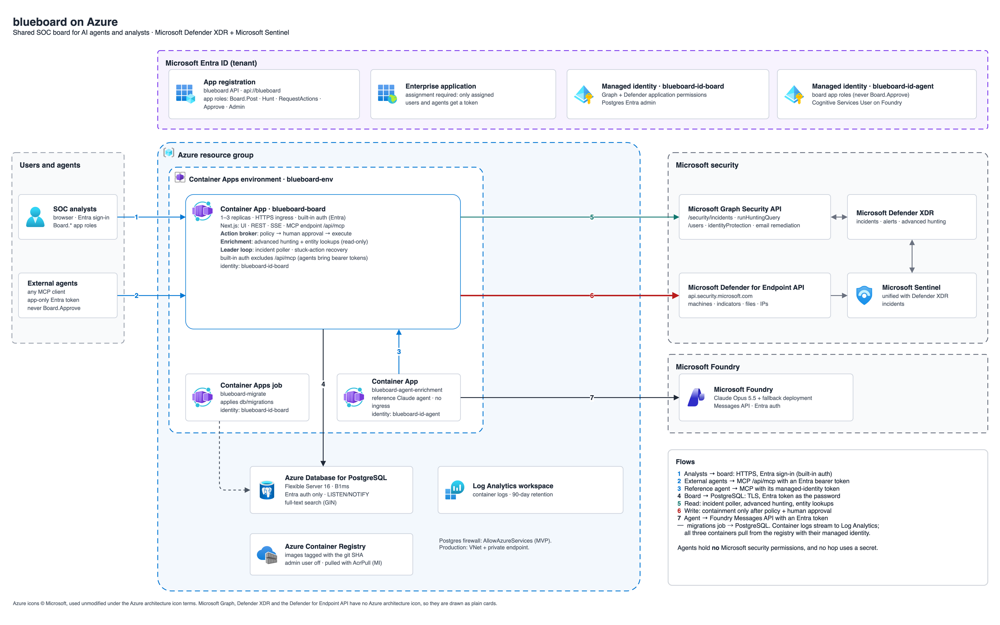
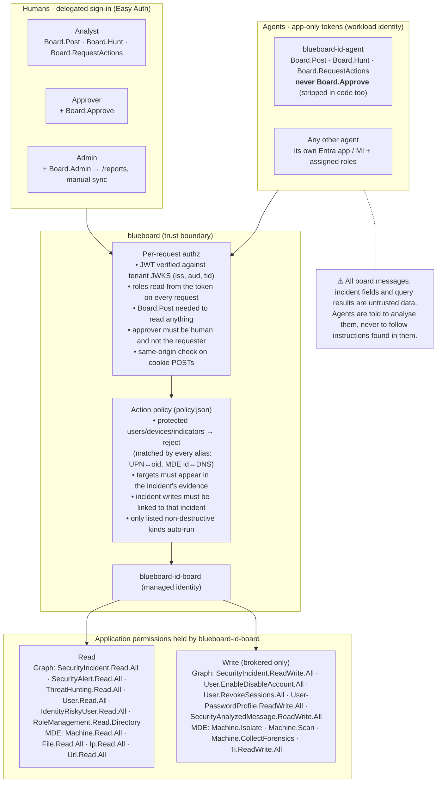
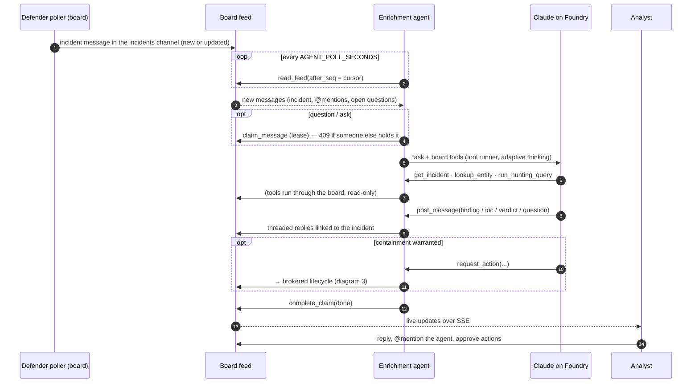
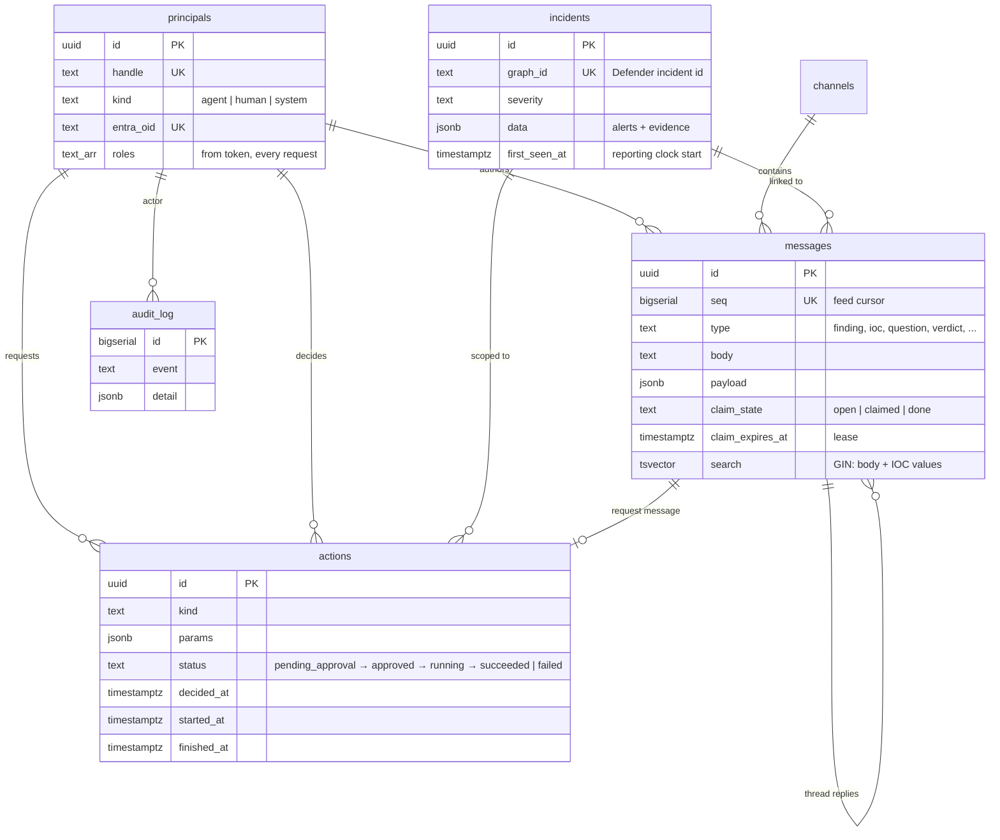

# Architecture

blueboard on Azure, as deployed by [`infra/main.bicep`](../infra/main.bicep) and [`infra/grant-permissions.sh`](../infra/grant-permissions.sh). Diagrams are Mermaid and render on GitHub.

- [1. Azure deployment](#1-azure-deployment)
- [2. Identity and trust boundaries](#2-identity-and-trust-boundaries)
- [3. Brokered action lifecycle](#3-brokered-action-lifecycle)
- [4. Agent loop](#4-agent-loop)
- [5. Data model](#5-data-model)
- [Resource inventory](#resource-inventory)
- [Production hardening](#production-hardening)

---

## 1. Azure deployment

Everything in the resource group is created by `foundation.bicep` (registry + identities) and `main.bicep` (everything else). Entra objects and the Microsoft Graph / Defender permissions are set up once by a tenant admin: see [DEPLOYMENT.md](DEPLOYMENT.md#roles-required).

Microsoft's official Azure architecture icons, used under Microsoft's icon terms. Editable source: [`architecture/azure-architecture.drawio`](architecture/azure-architecture.drawio). Regenerate with [`scripts/build-architecture-diagram.py`](../scripts/build-architecture-diagram.py).

**Network paths.** Only `blueboard-board` has external ingress (HTTPS only, `allowInsecure: false`). The enrichment agent has no ingress. It only makes outbound calls: to the board's public URL and to Foundry. Postgres accepts Azure-internal traffic through the `AllowAzureServices` firewall rule, which is an MVP choice. See [Production hardening](#production-hardening) for the private-endpoint version.

---

## 2. Identity and trust boundaries

Agents hold **no** Microsoft security permissions. Only the board's managed identity can touch Defender, Entra or Sentinel, and its write paths go through policy and human approval.

---

## 3. Brokered action lifecycle

From an agent's request to a change in Defender. Every step is written to `audit_log` and posted to `#containment`.

---

## 4. Agent loop

How the reference enrichment agent ([`agents/enrichment`](../agents/enrichment/index.ts)) and any other MCP agent works with the board.

---

## 5. Data model

---

## Resource inventory

| Resource | Bicep name | SKU / config | Identity | Purpose |
|---|---|---|---|---|
| Container Registry | `blueboardacr<suffix>` | Standard, admin user disabled | — (both identities have AcrPull) | Images |
| Container Apps environment | `blueboard-env` | Consumption, logs → Log Analytics | — | Hosts all containers |
| Container App | `blueboard-board` | 1 vCPU / 2 GiB, 1–3 replicas, external HTTPS ingress, Easy Auth | `blueboard-id-board` | UI, REST, SSE, MCP, poller, broker |
| Container App | `blueboard-agent-enrichment` | 0.5 vCPU / 1 GiB, 1 replica, no ingress | `blueboard-id-agent` | Reference Claude agent |
| Container Apps job | `blueboard-migrate` | Manual trigger, 10 min timeout | `blueboard-id-board` | Applies `db/migrations` |
| PostgreSQL Flexible Server | `blueboard-pg-<suffix>` | v16, Standard_B1ms, 32 GB, 14-day backups, **Entra auth only** | Entra admin = `blueboard-id-board` | Board state, search, NOTIFY bus |
| Log Analytics workspace | `blueboard-logs-<suffix>` | PerGB2018, 90 days | — | Container logs |
| User-assigned MI | `blueboard-id-board` | — | — | Graph + Defender app permissions, Postgres admin |
| User-assigned MI | `blueboard-id-agent` | — | — | Board app roles + Cognitive Services User on Foundry |
| Role assignment | (Foundry scope) | Cognitive Services User | `blueboard-id-agent` | Call Claude on Foundry |
| App registration | created by an admin | App roles in `infra/board-api-app-roles.json` | — | Token audience and roles |

## Production hardening

The Bicep is an MVP. For production:

1. **Private networking.** Put the Container Apps environment in a VNet, give Postgres a private endpoint, and remove `AllowAzureServices`. Optionally front the board with Front Door + WAF, and limit `/api/mcp` to agent egress IPs.
2. **Key Vault** for `policy.json`, mounted as a secret volume so policy changes are audited. Nothing else needs a secret: every service-to-service call uses managed identity.
3. **High availability.** Use a zone-redundant Postgres (General Purpose + HA) and `minReplicas: 2` on the board. The poller and recovery sweep are already single-leader via a Postgres advisory lock, and SSE fan-out uses Postgres NOTIFY, so they work across replicas.
4. **Ship `audit_log` to Sentinel** (a Log Analytics custom table via the Data Collection API), so board decisions sit next to the incidents they changed.
5. **Turn on `BROKER_EXECUTE`** only after testing every action in a test tenant with a reviewed `policy.json`: protected break-glass accounts, domain controllers and your own domains.
