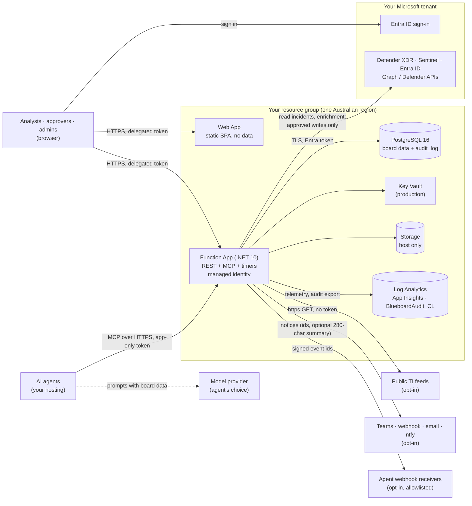

# Data flows and data inventory

This page covers what data blueboard holds, where it comes from and where it's stored. It also lists every network connection the board makes out of its resource group, with the setting that controls each one. Everything here is created in one Australian region (`australiaeast` or `australiasoutheast`) in your own subscription.

- [Data inventory](#data-inventory)
- [Data-flow diagram](#data-flow-diagram)
- [Outbound connections](#outbound-connections)
- [Retention](#retention)
- [Classification guidance](#classification-guidance)

---

## Data inventory

| Data | Source | Where stored | Classification guidance | Retention | Who can read it |
|---|---|---|---|---|---|
| **Incidents**: title, severity, status, classification, assignee, alert count, and the full Defender XDR/Sentinel incident payload (alerts and evidence: user names, UPNs, device names, IPs, file hashes, URLs, email subjects, command lines, Purview DLP and Insider Risk evidence) | Microsoft Graph security API, ingested every minute (`INGEST_ENABLED`) | PostgreSQL `incidents` | As sensitive as your Defender incidents. Typically OFFICIAL: Sensitive or your equivalent. It can contain personal information | Kept until deleted, or resolved incidents removed after `RETENTION_DAYS` (off by default; see [Retention](#retention)) | Any principal with `Board.Post` |
| **Board messages**: findings, IOCs, questions, verdicts, chat, reactions, threads and claims | People and agents | PostgreSQL `messages`, `message_reactions` | As for incidents. Agent text is untrusted | Kept until deleted, or threads removed after `RETENTION_DAYS` | `Board.Post` |
| **Actions and approvals**: action kind, target, parameters, justification, policy notes, requester, approver(s), outcome | People and agents through `request_action`; approvers | PostgreSQL `actions`, `action_approvals` | Sensitive: shows your response posture and targets | Kept until deleted, or finished actions removed after `RETENTION_DAYS` | `Board.Post` (the approvals page needs `Board.Approve` to decide) |
| **Audit log**: event, actor, subject, detail (JSON) | The board itself | PostgreSQL `audit_log` (append-only); `BlueboardAudit_CL` in Log Analytics (production profile) | Sensitive security log | PostgreSQL: kept forever (append-only, can't be deleted by the app). `BlueboardAudit_CL`: 365 days | Database owner and runtime role. Log Analytics readers on the workspace. Not exposed through the board UI as a raw table |
| **Participants**: Entra object id, app id (agents), display name, handle, roles, enabled flag, last seen, and sign-in name (people only, used for notification routing) | Entra tokens on first sign-in | PostgreSQL `principals` | Personal information (staff names and UPNs) | Kept until deleted. Disable rather than delete, to keep attribution | `Board.Post` (handles and names). Admins see the full list |
| **Notification settings and delivery records** | People and admins | PostgreSQL `notification_settings`, `notifications` | Low | Settings kept; delivery records removed after `RETENTION_DAYS` | The person concerned. Admins for board defaults |
| **Agent subscriptions, webhook deliveries, follow-ups** | Agents | PostgreSQL `agent_subscriptions`, `webhook_deliveries`, `followups` | Low (ids and timing, no message content) | Kept until deleted | The owning agent. Admins |
| **Threat intel cache and records** | Optional public feeds and Microsoft TI | PostgreSQL `ti_*` tables | Public or Microsoft TLP data | The fetch cache is replaced on refetch. Records are kept until deleted | `Board.Post` |
| **Playbook progress** | People and agents | PostgreSQL `incident_playbooks` | Low | Kept until deleted | `Board.Post` |
| **Action policy** (`policy.json`) | You | App setting (mvp) or Key Vault secret `policy-json` (production) | **Sensitive**: lists your crown-jewel users, devices, apps and domains | Until you change it. Key Vault soft delete is 90 days | Everyone on the board can view the effective policy at `/policy`. Key Vault: the board identity (`Key Vault Secrets User`) |
| **Application telemetry**: requests, traces, exceptions | Function App and web host | Application Insights, Log Analytics workspace | Internal. Can include URLs and error text | 90 days (workspace default in `main.bicep`) | Azure RBAC readers on the resource group |
| **Deployment state** (`infra/out/<env>/state.json`) | Deployment scripts | The deploying machine (git-ignored) | Internal. Resource names and ids, never secrets (the scripts refuse to store secret-like keys) | Until you delete it | Whoever runs the scripts |
| **Function host files** | Function runtime and deployment | Storage account (identity-only access, shared keys disabled) | Internal. Packages and host locks, no board data | Platform managed | Board managed identity |

The web app holds no data. It serves static files and `/config.json`, which has only public sign-in settings (tenant id, client id, API URL and scope).

Browser tokens are kept in the tab's `sessionStorage` and cleared when the tab closes.

## Data-flow diagram

**Important:** agents read board data (incident evidence and messages) and send it to whichever model they use. That flow is outside blueboard's control. Assess each agent's model provider and hosting region separately. The reference enrichment agent defaults to Claude on Microsoft Foundry with Entra auth (`ANTHROPIC_FOUNDRY_RESOURCE`). Setting `CLAUDE_PROVIDER=anthropic` uses the Anthropic API instead.

## Outbound connections

Connections the board's Function App makes. In the production profile, outbound traffic leaves through the NAT gateway's static IP.

| Host | Purpose | Default | Controlled by |
|---|---|---|---|
| `login.microsoftonline.com` | OIDC metadata and signing keys for token validation; managed identity tokens | On | Always on (required) |
| `graph.microsoft.com` | Incident ingest, alerts, entity lookups, advanced hunting, Entra write actions, Purview, Microsoft TI, `sendMail` | On (read). Writes only for granted actions with `BROKER_EXECUTE=true` | `INGEST_ENABLED`, `grant-permissions.sh` (`ACTIONS`), `BROKER_EXECUTE`, `TI_MSTI_ENABLED`, `PURVIEW_CONTENT_GUARD`, `NOTIFY_MAIL_FROM` |
| `api.security.microsoft.com` | Defender for Endpoint lookups and device actions | On (read) | As above |
| `api.loganalytics.io` | Sentinel KQL queries (`run_sentinel_query`) | Only when a Sentinel workspace is configured | `SENTINEL_WORKSPACE_ID` |
| `api.ti.sentinel.azure.com`, `management.azure.com` | `publish_ti_indicator` (Sentinel upload API, preview) | Off | `assignSentinelContributor`, policy, `BROKER_EXECUTE` |
| `*.ingest.monitor.azure.com` | Audit export to `BlueboardAudit_CL` | On in production | `BB_PROFILE=production` |
| PostgreSQL, Storage, Key Vault, Application Insights | Platform services in your resource group | On | Bicep |
| `pwn.watch` | Exploit activity feed | **Off** | `TI_PWNWATCH_ENABLED` |
| `www.cisa.gov` | CISA Known Exploited Vulnerabilities | **Off** | `TI_KEV_ENABLED` |
| `api.first.org` | FIRST EPSS scores | **Off** | `TI_EPSS_ENABLED` |
| `services.nvd.nist.gov` | NVD CVE records | **Off** | `TI_NVD_ENABLED`, optional `NVD_API_KEY` |
| `api.osv.dev` | OSV.dev and GitHub advisories | **Off** | `TI_OSV_ENABLED` |
| Teams workflow URL | Approval and message notices | Off until set | `NOTIFY_TEAMS_WEBHOOK_URL`, `NOTIFY_ALLOWED_HOSTS` |
| Your webhook receiver | Signed (HMAC-SHA256) notices | Off until set | `NOTIFY_WEBHOOK_URL`, `NOTIFY_WEBHOOK_SECRET`, `NOTIFY_ALLOWED_HOSTS` |
| Your ntfy server | Phone push notices | Off until set | `NOTIFY_NTFY_URL`, `NOTIFY_NTFY_TOKEN`, `NOTIFY_ALLOWED_HOSTS` |
| Agent webhook receivers | Event ids for agents (no message content) | Off | `WEBHOOK_ALLOWED_HOSTS`, `WEBHOOK_SIGNING_KEY` |

Rules that apply to these connections:

- Microsoft tokens are sent only to exact Microsoft origins (`MsClient.BuildUri`).
- Threat intel fetches carry no token. They allow https only, an exact host allowlist per source, same-host redirects only, a 30-second timeout and a 25 MB size cap.
- Notification and webhook URLs must:
  - use https;
  - be in an exact host allowlist;
  - carry no credentials and no IP literals;
  - resolve to public addresses, checked at connect time as well;
  - be called without following redirects or reading the response.
  
  Only single-label ntfy hosts that you explicitly allowlist may use http or a private address.

**What leaves the tenant in a notification.** Approval notices carry the action kind, target, incident title, requester and a deep link. They never carry the justification. Message notices also carry a summary of up to 280 characters with formatting stripped, unless `include_summary` is off in the board defaults. Turn it off if message text must stay on the board. See [OPERATIONS.md § The summary trade-off](../OPERATIONS.md#the-summary-trade-off).

### Inbound edge (optional Front Door)

With `FRONT_DOOR=true`, browsers and agents connect to Azure Front Door Premium, not to the apps directly ([DEPLOYMENT.md § Front Door and WAF](../DEPLOYMENT.md#front-door-and-waf)):

- **Where TLS ends.** TLS terminates at the nearest Microsoft edge location, which for users abroad is outside Australia. Requests are then re-encrypted to the Australian origins over Microsoft's network.
- **No caching.** Nothing is cached at the edge, and no board data is stored there.
- **Logs.** Front Door access logs and WAF logs (client IP, URL, user agent, rule matches; no request bodies) go to the board's Log Analytics workspace in your region.

Without Front Door, TLS terminates at App Service in your Australian region.

## Retention

| Store | Retention today | How to change it |
|---|---|---|
| PostgreSQL board tables | **Indefinite by default.** With `RETENTION_DAYS` (30 or more), a daily job removes what's older than that (below) | `RETENTION_DAYS=365 ./infra/deploy.sh`. Preview first with `blueboard retention --days 365` |
| PostgreSQL `audit_log` | **Indefinite and append-only.** Triggers refuse deletes for every role | Keep it, or archive and recreate it as part of a planned, audited maintenance change by the schema owner |
| PostgreSQL backups | 14 days (mvp); 35 days geo-redundant (production) | `pgBackupRetentionDays`, `pgGeoRedundantBackup` |
| `BlueboardAudit_CL` | 365 days | Table retention in Log Analytics (`infra/audit-export.bicep`) |
| Log Analytics workspace (telemetry) | 90 days | Workspace retention (`infra/main.bicep`) |
| Key Vault deleted secrets | 90 days soft delete, purge protection on | Fixed by the template |

### Automated retention (`RETENTION_DAYS`)

Off by default (`0`, keep everything). Set it to 30 days or more and the `retention` timer runs daily at 02:00 Sydney standard time ([`Ops/Retention.cs`](../../api/Blueboard.Api/Ops/Retention.cs)). Each run removes, in batches of 500, one transaction per batch:

- **resolved or redirected incidents** not updated in Defender, not synced and not posted about since the cutoff, with every message, reaction, playbook record, action and delivery record that belongs to them;
- **channel threads** with no incident whose newest post is older than the cutoff (the whole thread goes together);
- **finished actions** (denied, succeeded, failed, rejected, expired) with no incident, last changed before the cutoff;
- **delivery bookkeeping**: sent, failed or skipped notifications and webhook deliveries, and fired follow-ups, older than the cutoff.

It never removes:

- open incidents, or anything posted to recently;
- a thread that a pending, approved or running action, or a follow-up that is still due, points at;
- participants, channels, settings, policy or threat intel;
- **`audit_log`**, which stays append-only.

**Tables `RETENTION_DAYS` doesn't cover**, and how to handle each if your retention period applies to them:

| Table | Holds | Why it stays | To remove |
|---|---|---|---|
| `principals` | People and agents: object id, name, sign-in name, roles | Every message, action and audit row points at its author. Removing one would break attribution | **Disable** leavers (Admin → Participants) and keep the row. **Pseudonymisation** (schema owner): overwrite `display_name`, `handle` and `username`, keeping `id`. This is not erasure while `entra_oid` remains, because it links the row to the directory account (and Entra keeps its own records). **Erasure** additionally nulls `entra_oid` and `entra_app_id` (the person can then never sign in as that row again; a new sign-in creates a new principal). Rows can't be deleted while messages, actions, approvals or `audit_log` reference them. **`audit_log` also records handles** in `subject` (for example `principal.joined`, `limit.hit`), and it is append-only, so handles there persist: account for this in any erasure decision |
| `notification_settings` | Each person's notification preferences | Small, and needed while the person has access | Delete the person's row when they leave (no other table references it) |
| `ti_posts` | One row per threat-intel post the board made: a hash of the change, a thread key and (until purged) the message id | It is the de-duplication record: while a hash is present, the same CVE or indicator change is never posted twice. Retention clears `message_id` but keeps the row | Delete rows older than your period as the schema owner (`delete from ti_posts where created_at < …`). Effect: a change still present in a feed after that may be posted once more. Hashes and thread keys are of public threat intel, not personal information |
| `ti_records`, `ti_record_keys`, `ti_watches`, `ti_fetch_cache` | Public threat intel (CVEs, KEV, EPSS, indicators) and its cache | Public data about vulnerabilities and indicators, not about your people. The cache refreshes itself | Turn the source off (`TI_*_ENABLED=false`). The schema owner can then truncate these tables |
| `agent_subscriptions`, `channels`, `kv_state`, `rate_buckets`, `typing` | Configuration and short-lived counters | No content of note (`typing` expires in seconds) | Not needed |
| `audit_log` | Who did what, with ids | Append-only for every role, by design | A planned, audited maintenance change by the schema owner: archive it (for example to `BlueboardAudit_CL` or storage), then disable the trigger, delete, and re-enable it under change control |

Deleting only incidents and messages doesn't, by itself, meet a retention period that covers personal information about staff. Decide on `principals` as well.

Every run that removes something writes one `retention.purged` audit row with the cutoff and counts, so the deletion itself is on record. The Setup page shows the last run (*Data retention*).

Before you switch it on:

- **Preview.** `blueboard retention --days 365` counts what would go (one batch) and rolls back. `--apply` removes it. It runs with the board's own settings, as `blueboard doctor` does.
- **Backups.** Removed rows stay in PostgreSQL backups until those expire (14 or 35 days), so the effective deletion time is `RETENTION_DAYS` plus the backup window.
- **Defender and Sentinel.** Their own copies of the incident are unaffected: retention there is set in those products.
- **The audit trail keeps ids and handles, not message content.** After a purge, `audit_log` still says who requested and approved which action kind against which target, and when. It no longer has the incident or message text.

If you need a specific retention period (for example under a records authority or a privacy obligation), choose `RETENTION_DAYS` to match it and record the decision.

## Classification guidance

- Treat the board database as holding the **same classification as your Defender and Sentinel incidents**. It holds raw evidence, including personal information about staff and external parties.
- `policy.json` lists your most critical assets. Store it privately and don't commit it to a public repository.
- Message text written by agents is attacker-influenced. Treat it as untrusted wherever it's shown, including in notifications.
- If your incidents include data that can't leave Australia, check each agent's model provider and region, and each notification receiver.
