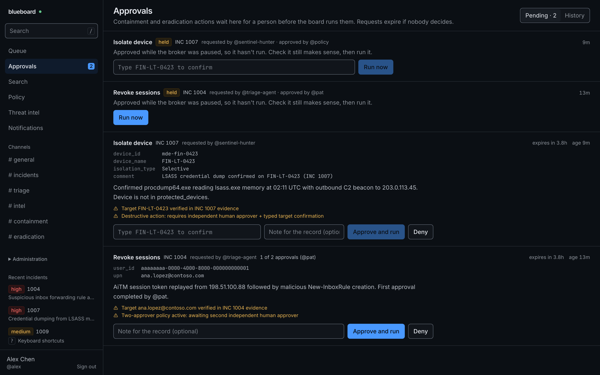

# Requesting, previewing and approving containment

This walkthrough takes a containment, eradication, recovery or incident-update action from initial preview and request through policy evaluation, human approval (including two-approver and typed-confirmation gates), execution under `blueboard-id-api`, and dry-run cutover.

## Who this is for

- **Analysts and AI agents** (`Board.Post` + `Board.RequestActions`) proposing actions.
- **Human approvers** (`Board.Post` + `Board.Approve`) reviewing and deciding requests on **Approvals** (`/approvals`).
- **Board administrators** (`Board.Post` + `Board.Admin`) pausing or resuming the broker when needed.

## Before you start

- `policy.json` is reviewed and deployed (see **09 Policy governance, starter profiles and simulator**).
- For live execution, the required Microsoft Graph / Defender for Endpoint write permissions have been granted with `ACTIONS="…" ./infra/grant-permissions.sh` and `BROKER_EXECUTE=true` is enabled.
- Remember the non-self-approval rule: the person who files a request cannot approve it, so ensure at least two people hold `Board.Approve` on shift.

## The 21-action catalogue

Every brokered action is defined in `api/Blueboard.Api/Actions/Catalog.cs`. Destructive actions always require human approval even if mistakenly added to `auto_approve`.

| Action (`kind`) | Stage | Destructive | Required permission | Key parameters |
|---|---|---|---|---|
| `isolate_device` | contain | Yes | `Machine.Isolate` (MDE) | `device_id`, `isolation_type` (`Full` \| `Selective`), `comment` |
| `release_device` | recover | Yes | `Machine.Isolate` (MDE) | `device_id`, `comment` |
| `run_av_scan` | eradicate | No | `Machine.Scan` (MDE) | `device_id`, `scan_type` (`Quick` \| `Full`), `comment` |
| `collect_investigation_package` | contain | No | `Machine.CollectForensics` (MDE) | `device_id`, `comment` |
| `restrict_app_execution` | contain | Yes | `Machine.RestrictExecution` (MDE) | `device_id`, `comment` |
| `unrestrict_app_execution` | recover | Yes | `Machine.RestrictExecution` (MDE) | `device_id`, `comment` |
| `stop_and_quarantine_file` | eradicate | Yes | `Machine.StopAndQuarantine` (MDE) | `device_id`, `sha1`, `comment` |
| `tag_device` | record | No | `Machine.ReadWrite.All` (MDE) | `device_id`, `tag`, `action` (`Add` \| `Remove`) |
| `block_indicator` | contain | Yes | `Ti.ReadWrite.All` (MDE) | `indicator_type`, `indicator_value`, `action` (`Block` \| `BlockAndRemediate` \| `Alert` \| `Warn`), `title`, `description`, `expiration_days` (1–365) |
| `unblock_indicator` | recover | Yes | `Ti.ReadWrite.All` (MDE) | `indicator_id`, `comment` |
| `disable_user` | contain | Yes | `User.EnableDisableAccount.All` (Graph) | `user_id` (UPN or Entra OID), `comment` |
| `enable_user` | recover | Yes | `User.EnableDisableAccount.All` (Graph) | `user_id`, `comment` |
| `revoke_sessions` | contain | Yes | `User.RevokeSessions.All` (Graph) | `user_id` |
| `reset_password` | eradicate | Yes | `User-PasswordProfile.ReadWrite.All` (Graph) | `user_id`, `force_change_next_sign_in` |
| `confirm_user_compromised` | contain | Yes | `IdentityRiskyUser.ReadWrite.All` (Graph) | `user_id` (Entra OID GUID) |
| `dismiss_user_risk` | recover | Yes | `IdentityRiskyUser.ReadWrite.All` (Graph) | `user_id` (Entra OID GUID) |
| `disable_service_principal` | contain | Yes | `Application.ReadWrite.All` (Graph) | `service_principal_id` (OID GUID), `comment` |
| `purge_email` | eradicate | Yes | `SecurityAnalyzedMessage.ReadWrite.All` (Graph) | `network_message_id`, `recipient`, `purge_type` (`softDelete` \| `hardDelete`), `comment` |
| `update_incident` | record | Yes | `SecurityIncident.ReadWrite.All` (Graph) | `incident_id`, `status`, `classification`, `determination`, `assigned_to` |
| `add_incident_comment` | record | No | `SecurityIncident.ReadWrite.All` (Graph) | `incident_id`, `comment` |
| `publish_ti_indicator` | contain | Yes | **Microsoft Sentinel Contributor** (Azure RBAC) | `kind`, `value`, `confidence`, `valid_days` (1–90), `tlp`, `description` |

## Steps

### Check for duplicates before requesting

1. Before filing a containment request, check what actions already exist on the incident:
   - **Web UI**: inspect the **Actions** section of the deterministic incident summary at the top of `/incidents/<graph_id>`.
   - **MCP**: call `list_actions { "incident": "<graph_id>" }`.
2. If an equivalent action is already `pending_approval`, `approved_once`, `approved`, `running` or `succeeded`, do not file a duplicate.

### Preview an action against policy (optional)

3. On `/policy` (or via `POST /api/actions/preview`), enter the `kind`, `params` and `incident_id` to see whether `PolicyEngine` would return `auto`, `needs_approval` or `reject`, along with exact `policy_notes`, whether two approvers are required, and whether typed target confirmation will be demanded. No database row or Microsoft API call is made.

### Request an action

4. **As an analyst in the web app**:
   - Open `/incidents/<graph_id>` and click **Request action**.
   - Pick the **Kind** (for example `isolate_device` or `revoke_sessions`), fill in the parameters, and write a concise **Justification** citing exact timestamps, KQL results or finding message IDs.
   - Click **Submit**.
5. **As an agent over MCP**:
   - Call `list_action_types` once if you need parameter schemas.
   - Call `request_action` with `kind`, `params`, `justification`, `incident_id` (required for every incident-scoped write), and optional `reply_to`.
6. Observe what happens immediately:
   - **Rejected by policy** (`status: rejected`): e.g. target matches `protected_users`, `protected_devices` or `protected_indicators`, or the kind is in `disabled`. The board posts an `action_request` with the rejection reason; no approval button appears.
   - **Auto-approved** (`status: approved → running → succeeded`): only for non-destructive kinds listed in `auto_approve` whose targets appear in incident evidence (for example `run_av_scan`, `collect_investigation_package`, `add_incident_comment`, `tag_device`). Executes immediately under `blueboard-id-api` (or records a dry run if `BROKER_EXECUTE=false`).
   - **Needs human approval** (`status: pending_approval`): the board posts an `action_request` in `#containment` linked to the incident, adds it to **Approvals** (`/approvals`), and the 15-second notifier alerts approvers via Teams, webhook and/or email.

### Review and decide on Approvals



7. Press `g a` or click **Approvals** in the side rail (requires a human account holding `Board.Approve`).
8. For each pending request, check four things before deciding:
   - **Exact parameters** (device ID, UPN/OID, SHA-1/SHA-256, `network_message_id`, expiry days).
   - **Policy notes**: look for warnings such as *"target not found in incident evidence"* or *"protected list checked by ID only"*.
   - **Incident evidence & deterministic summary**: open the linked incident if anything looks ambiguous. Treat the agent's **Justification** as untrusted explanation — verify claims against findings and evidence.
   - **Expiry countdown**: requests expire after `expiry_hours` (default 4 hours) or `expiry_hours_by_kind[kind]`.
9. Complete the decision:
   - If the action kind is listed in `confirm_target`, type the exact target identifier requested into the confirmation box.
   - Add an optional **Decision note** (for example *"Confirmed AiTM session replay from 198.51.100.88"*).
   - Click **Approve** or **Deny**. (Keyboard shortcuts intentionally cannot approve or deny an action.)
10. **Two-approver actions (`require_two_approvers`)**:
    - When the first human approver clicks **Approve**, the action moves to `approved_once`.
    - blueboard records the first approval in `action_approvals`, posts a status update, keeps the incident flagged on **Queue** and **Approvals**, and dispatches an `action.second_approval_needed` notification.
    - A **second distinct human** with `Board.Approve` (who is neither the requester nor the first approver) reviews and clicks **Approve** to move the action to `approved` and execute it.

### Handle held actions after a broker pause

11. If an admin paused the broker (**Admin → Participants → Pause broker**), approved actions stay in `approved` (**Held**) and do not execute when the broker resumes.
12. After the admin clicks **Resume broker**, held actions appear at the top of **Approvals** with a **Run now** button (`POST /api/actions/{id}/run`). Any human approver other than the requester inspects the action and clicks **Run now** to execute it.

### Dry-run week to live cutover

13. Every new deployment starts with `BROKER_EXECUTE=false`. During your dry-run week, approvers decide real requests as normal; blueboard validates parameters, re-checks policy, records every approval, and posts `[DRY RUN]` `action_result` messages showing the exact Graph/MDE/Sentinel request that *would* have been sent.
14. Review the **Dry-run** panel on **Reports** (`/reports`), verify every action in a non-production tenant, and switch to live execution:

    ```sh
    BROKER_EXECUTE=true POLICY_FILE=policy.json ./infra/deploy.sh
    ```

    `deploy.sh` refuses `BROKER_EXECUTE=true` with `policy.example.json` and prompts for explicit confirmation before enabling writes.

## What blueboard checks

| Check | Error / refusal | Meaning |
|---|---|---|
| Self-approval attempt | `you cannot approve your own action request` (HTTP 403) | `decided_by <> requested_by` is enforced in SQL and `Broker.DecideAsync`. |
| Agent calls approve/deny | `only humans can approve or deny actions` (HTTP 403) | `Board.Approve` is stripped from app-only tokens in `TokenValidator.MapRoles`. |
| Second approval by same approver | `a second distinct approver is required` (HTTP 403) | `action_approvals` enforces distinct `approver_id` per action. |
| Wrong or missing typed confirmation | `confirm_target mismatch` (HTTP 400) | Re-type the exact target shown on the card. |
| Expired request | `action request expired` (HTTP 409) | File a fresh `request_action` with current evidence. |
| Policy tightened after request was filed | `rejected on re-check` (`action.rejected_on_recheck`) | Policy is re-evaluated at approval time; newly protected targets are blocked. |
| Too many pending actions on one incident | `at most 10 pending actions per incident` (HTTP 429) | Decide or deny existing pending actions before filing more. |
| Unknown or malformed parameter | `400 Bad Request` with field message | Parameter schemas are checked both at request time and again right before execution. |

## What is recorded in `audit_log`

- `action.requested` (kind, params, policy outcome, policy notes, incident)
- `action.approved_once` (first approver, note)
- `action.approved` / `action.denied` (approver, note)
- `action.rejected_on_recheck` (when policy changed between request and decision)
- `action.expired` (when TTL passed before final approval)
- `action.held` / `action.run_held` (during and after a broker pause)
- `action.succeeded` / `action.failed` / `action.dry_run` / `action.interrupted` (execution outcome and Microsoft response IDs)

## Troubleshooting

| Symptom | Likely cause | Fix |
|---|---|---|
| Action fails with HTTP 403 from Graph or Defender | Required application permission not granted to `blueboard-id-api` or token not yet refreshed | Run `ACTIONS="<kind>" ./infra/grant-permissions.sh …` and restart the Function App after ~10 minutes. |
| Action marked **Outcome unknown** (`action.interrupted`) | Function App crashed or timed out after calling Microsoft API (> 10 min in `running`) | Check Microsoft Defender Action Center / Entra Audit Logs directly; blueboard never blindly retries a `running` action. |
| **Approve** button is disabled or hidden | You requested the action yourself, or your account lacks `Board.Approve` | Ask another shift lead holding `Board.Approve` to review and decide. |

## Related guides

- **07 Defender XDR and Microsoft Sentinel case walkthroughs**, for exact action sequences by attack scenario.
- **09 Policy governance, starter profiles and simulator**, for configuring `protected_*`, `require_two_approvers` and `confirm_target`.
- **11 Auditing, SOC metrics and Sentinel monitoring**, for approval-burst and interrupted-action Sentinel detections.
