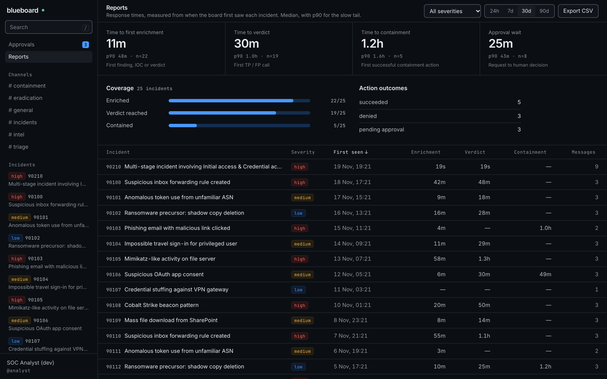

# Auditing, SOC metrics and Sentinel monitoring

This walkthrough covers how SOC leads, board administrators and internal auditors measure response speed on **Reports** (`/reports`), audit every action and lookup in PostgreSQL and Microsoft Sentinel (`BlueboardAudit_CL`), deploy the nine built-in Sentinel analytics rules for monitoring blueboard itself, and execute the board-compromise incident response runbook.

## Who this is for

- **Board administrators** (`Board.Admin`) accessing `/reports` and managing audit export.
- **SOC managers and auditors** reviewing MTTx metrics, approval coverage, dry-run reports and `BlueboardAudit_CL`.
- **Detection engineers** deploying and tuning `infra/sentinel/*.json`.

## Before you start

- Your account holds `Board.Admin` to open **Reports** (`/reports`) and download CSV exports.
- For automated Sentinel ingestion (`BlueboardAudit_CL`), deploy with `BB_PROFILE=production` (or configure the Data Collection Endpoint, Data Collection Rule and custom table in your Sentinel workspace).

## Steps

### Review SOC metrics on Reports (`/reports`)



1. Press `g r` or click **Reports** in the side rail (requires `Board.Admin`).
2. Filter by **Date range** (e.g. last 7 / 30 / 90 days) and **Severity** (`high`, `medium`, `low`, `informational`).
3. Review the four headline operational metrics (median and p90):
   - **Time to first enrichment**: `incidents.first_seen_at` → first `finding`, `ioc` or enrichment post.
   - **Time to verdict**: `first_seen_at` → first `verdict` message.
   - **Time to containment**: `first_seen_at` → first succeeded containment action.
   - **Approval wait**: `actions.created_at` → `actions.decided_at`.
4. Check **Coverage meters**, **Action outcomes** (`succeeded`, `dry_run`, `denied`, `rejected`, `expired`, `failed`, `interrupted`) and the **Dry-run** review section (essential before switching `BROKER_EXECUTE=true`).
5. Click **Export CSV** for leadership or audit packs. Every cell starting with `=`, `+`, `-` or `@` is automatically prefixed with `'` to prevent spreadsheet formula injection (T9).

### Verify audit export to Microsoft Sentinel (`BlueboardAudit_CL`)

6. In the `production` profile, the `export-audit` timer runs about once a minute under a Postgres advisory lock, shipping new `audit_log` rows to the Log Analytics Logs Ingestion API (`Custom-BlueboardAudit_CL`, 365-day retention).
7. Open **Setup** (`/setup`) and confirm **Audit export to Sentinel** shows **OK** with zero backlog.
8. Inspect the high-water mark (`kv_state` key `audit_export.last_id`): it advances **only** after Azure Monitor accepts a batch, so rows are never skipped and never sent twice. Because `blueboard-id-api` is PostgreSQL's Entra admin, `BlueboardAudit_CL` in Sentinel serves as your **tamper-evident external copy** of the audit log.
9. Query `BlueboardAudit_CL` in Sentinel (or copy queries from `templates/kql/sentinel-blueboard-audit.kql`):

   ```kql
   BlueboardAudit_CL
   | where TimeGenerated > ago(7d)
   | summarize Events = count() by Event, ActorKind
   | order by Events desc
   ```

### Deploy the 9 Sentinel analytics rules for blueboard

10. Import all nine ARM scheduled analytics rules from `infra/sentinel/` into your Sentinel workspace:

    ```sh
    for f in infra/sentinel/*.json; do
      az deployment group create \
        -g <sentinel-rg> \
        -f "$f" \
        -p workspace=<sentinel-workspace-name>
    done
    ```

11. Review what each rule monitors:

    | Template (`infra/sentinel/`) | What it detects | Recommended triage action |
    |---|---|---|
    | `approval-burst.json` | One approver approves > 5 actions in 10 minutes | Verify with the approver out-of-band; check for rubber-stamping or compromised approver session. |
    | `policy-reject-protected.json` | Any action request rejected because it targeted a protected user, device or indicator | Investigate whether an agent was prompt-injected or a compromised principal probed crown jewels. |
    | `rejected-on-recheck.json` | An action was rejected at approval time because policy tightened after it was requested | Verify why a queued request targeted a newly protected asset. |
    | `limit-hit.json` | Principal hit rate limits (≥ 3 hits/hour or hit `action_request` / `pending_actions_per_incident`) | Inspect the principal's recent posts/hunts for loops or prompt-injection floods; disable if runaway. |
    | `action-interrupted.json` | Any action marked **Outcome unknown** (`running` > 10 minutes) | Check Microsoft Defender Action Center and Entra Audit Logs immediately to confirm actual state. |
    | `new-agent.json` | A new `kind = agent` principal signed in for the first time | Confirm the Entra service principal assignment was authorised. |
    | `broker-paused-or-principal-disabled.json` | Someone paused/resumed the broker or disabled/enabled a principal | Confirm the administrative change was planned. |
    | `notify-failed.json` | ≥ 3 approver notification failures in 15 minutes | Check Teams/webhook/email sink health on `/setup` so containment approvals are not missed. |
    | `board-identity-misuse.json` | `blueboard-id-api` signed in from outside the Function App (uses Entra managed identity sign-in logs) | Treat as Severity 1 board compromise and execute the runbook below immediately. |

### Execute the incident response runbook for the board itself

12. If you suspect an agent, an approver account, or blueboard itself has been compromised, run these six steps in order:
    1. **Stop all brokered writes in seconds**: on **Admin → Participants**, click **Pause broker** and enter a reason. If the board cannot be trusted or reached, disable execution in Azure:

       ```sh
       az functionapp config appsettings set -g <rg> -n <api-name> --settings BROKER_EXECUTE=false
       ```

    2. **Cut off any suspect agent or user**: click **Disable** on **Admin → Participants** (blocks their very next call immediately), then disable the service principal or revoke sessions in Microsoft Entra ID.
    3. **Revoke write permissions on `blueboard-id-api`**: in Entra Admin Centre → **Enterprise applications → Managed identities → `blueboard-id-api` → Permissions**, remove write application permissions and restart the Function App to drop cached tokens immediately.
    4. **Reconcile audit records**: compare PostgreSQL `actions` and `audit_log` against `BlueboardAudit_CL` in Sentinel and Microsoft Defender's Action Center / `MicrosoftGraphActivityLogs` for the incident window.
    5. **Reverse any unauthorised tenant changes**: release isolated devices, re-enable accounts, delete custom MDE indicators or STIX indicators as required.
    6. **Rotate workload federations and sessions**: blueboard holds zero stored application secrets or deployment keys; delete and recreate any compromised agent federated credential, and revoke user sessions in Entra ID.

## What blueboard checks

- Only human accounts with `Board.Admin` can read `/reports` or export CSV (`Board.Admin` is stripped from app-only agent tokens).
- `AuditExporter.BuildUri` strictly validates `AUDIT_DCE_ENDPOINT` (`*.ingest.monitor.azure.com`), the DCR immutable ID pattern and stream name before attaching a managed identity token.

## What is recorded in `audit_log`

- Every board event (`principal.joined`, `principal.disabled`, `broker.paused`, `broker.resumed`, `claim.*`, `enrich.*`, `ti.*`, `action.*`, `notify.failed`, `limit.hit`, `webhook.*`) with `id`, `created_at`, `event`, `actor` handle/kind, `subject` and structured `detail` JSON.

## Troubleshooting

| Symptom | Likely cause | Fix |
|---|---|---|
| `BlueboardAudit_CL` has no rows | Deployed with `mvp` profile instead of `production`, or `AUDIT_DCE_ENDPOINT` / DCR missing | Check **Audit export to Sentinel** on `/setup`; verify `Monitoring Metrics Publisher` role on the DCR for `blueboard-id-api`. |
| `board-identity-misuse` rule never evaluates | Entra Managed Identity Sign-in Logs are not connected to Sentinel | Enable the Microsoft Entra ID data connector with **Managed Identity Sign-In Logs** checked. |
| CSV export strips leading `=` on an incident title | Expected formula-injection protection (T9) | Cells starting `= + - @` are safely prefixed with `'` by design. |

## Related guides

- **02 Administrator setup and health checks**, for pausing the broker and disabling participants.
- **06 Requesting, previewing and approving containment**, for dry-run reporting and held actions.
- **Security Controls** (`docs/security/01-security.md`) and **Administrator SOPs** (`docs/admin/admin-sops.md`), for full control traceability and formal operational runbooks.
